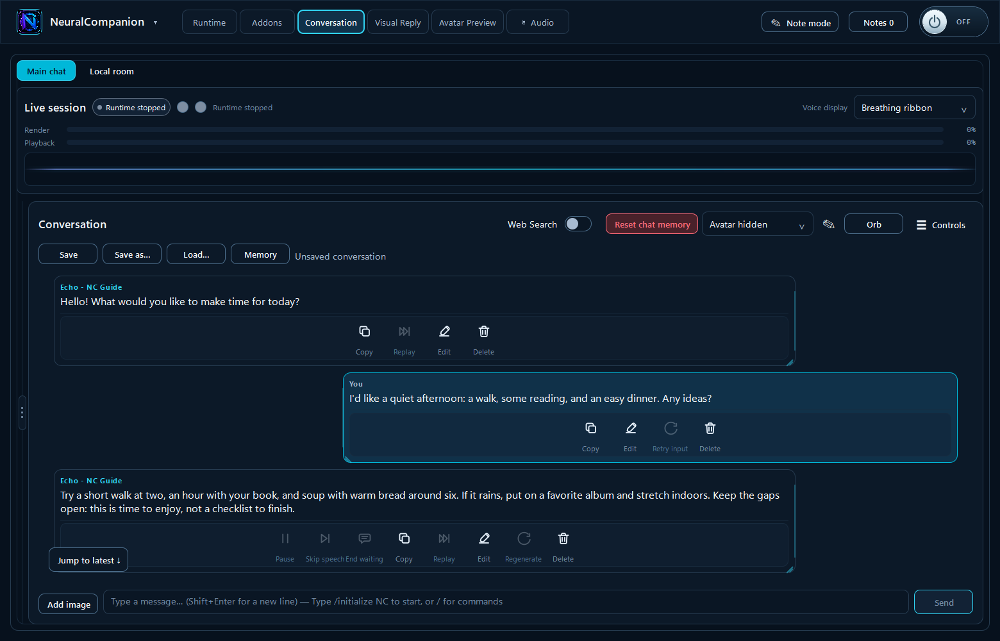
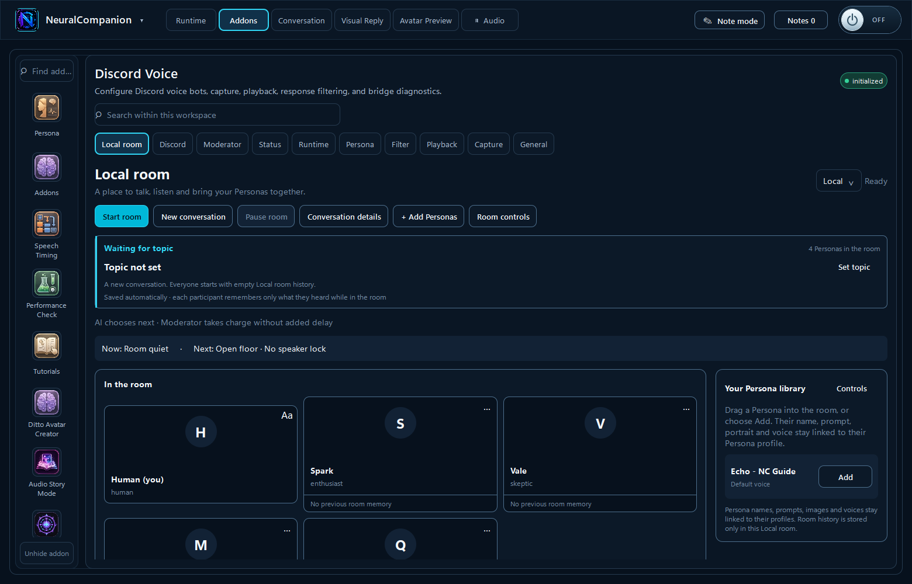

# NeuralCompanion

**An AI companion with a personality, a voice, and an optional animated face.**

NeuralCompanion is a Windows desktop app for conversations with characters you
create. Use a local language-model server or a supported hosted provider, then
add speech, avatars, images, memory, and tools as you need them. Text chat works
without an avatar or speech output.

[First run](docs/manual/first-run.md) · [User manual](docs/manual/index.md) ·
[All addon guides](docs/addons/index.md) · [Troubleshooting](docs/troubleshooting.md)

Captured from the native desktop on 24 October 2026 with an illustrative
conversation. The runtime is stopped in this example; initialize NC to send
new messages. See [Using Main chat](docs/manual/conversation.md).

## Get started

This repository targets **Windows and Python 3.11**. Optional local talking-avatar
engines require compatible NVIDIA CUDA hardware and separate runtimes. Hosted
providers require their own API access. See [Installation](docs/install.md) for
requirements, installer choices, and command-line instructions.

1. Download or clone this repository and run **`INSTALL_NEURAL_COMPANION.bat`**.
   Select the main runtime and the optional components you want.
2. Launch **`run_neural_companion.bat`**.
3. Open **Runtime → Runtime Session → LLM**. Configure a provider and model,
   test the connection, and choose **Make active**. For local chat, start your
   LM Studio or Ollama server first.
4. For a simple first test, choose **Text Only** in **Session setup** and
   **None** for both **Text-to-speech** and **Avatar**, activating those choices
   if needed.
5. Use **Initialize NC** in the header. Once ready, open
   **Conversation → Main chat**, type a greeting, and choose **Send**.

Opening provider settings and making that provider active are separate actions.
If the first reply fails, check the active model and the Conversation console
before adding speech or an avatar.

For a guided introduction, open **Addons → Tutorials → First Run**. The written
[first-run guide](docs/manual/first-run.md) explains each step and what to expect.

## Find your way around

The desktop has five main views. Workspaces can be docked or floated; hidden
views can be restored through the NeuralCompanion logo/name menu.

| View | What you do there |
| --- | --- |
| **Runtime** | Choose active models and providers; configure input, memory, awareness, and interface appearance. |
| **Addons** | Open Persona, Tutorials, creative tools, rooms, remote access, and other enabled addons. |
| **Conversation** | Read and send main-chat messages, or open the active Local/Discord room conversation. |
| **Visual Reply** | Browse and inspect generated images. |
| **Avatar Preview** | View avatar output from the selected runtime. |

See [Addon management](docs/manual/addons.md) if a tool is missing. Installing an
addon, enabling it, configuring it, and selecting it as the active provider are
different steps.

## Make it your own

| What you want to do | Where to start |
| --- | --- |
| Create characters, portraits, voices, and model overrides | [Personas](docs/manual/personas.md) and [Voice Studio](docs/addons/voice_studio.md) |
| Send, save, edit, and customize messages | [Using Main chat](docs/manual/conversation.md) |
| Configure voice input and spoken replies | [Chat and speech](docs/manual/chat-and-tts.md) |
| Use a talking avatar or expression images | [Avatars](docs/manual/avatars.md), [MuseTalk](docs/manual/musetalk.md), and [Ditto](docs/manual/ditto.md) |
| Keep conversation summaries or search reference documents | [Memory and document knowledge](docs/manual/memory.md) |
| Generate images or share selected screen, webcam, or clipboard context | [Visual Reply and awareness](docs/manual/visual-reply-and-sensory.md) |
| Show a desktop Orb or audio-reactive visuals | [Companion Orb and AI Presence](docs/addons/ai_presence_companion_orb.md) |
| Talk with several characters in main chat | [Buddy Chat](docs/addons/buddy_chat.md) |
| Run a moderated discussion locally or in Discord voice | [Local Room](docs/addons/local_room.md) and [Discord room](docs/addons/discord_voice.md) |
| Create roleplay scenes or narrated chapters | [Roleplay](docs/addons/roleplay.md) and [Audio Story Mode](docs/addons/audio_story_mode.md) |
| Connect a compatible phone client | [Main Chat Remote](docs/addons/main_chat_remote.md) |
| Add web search, music awareness, hotkeys, or hardware integrations | [Complete addon catalog](docs/addons/index.md) |
| Give a persona external tools | [MCP connections and persona tools](docs/addons/mcp.md) |
| Play chess with a persona or another person | [Companion Chess](docs/addons/companion_chess.md) |

The updated Android download is deferred while its signing and phone testing
are completed. Phone source is included for builders; the existing alpha APK
remains a legacy download with unverified compatibility with desktop 0.5.0.
See [phone build availability](docs/addons/main_chat_remote.md#phone-build-availability).

Main chat and the room workflow have separate conversations. Follow the
stop/save prompts when switching between them. In rooms, participants normally
retain context from speech delivered while they were present. Showing a full
reply early does not add unheard speech to memory. **Skip speech** is an
explicit exception: it retains the complete reply for the AI participants
present in the room while stopping its vocalization.

The current guide screenshots were refreshed from the native UI on 24 October
2026 in an isolated example session. Settings pages illustrate where controls
live; they do not establish working provider connections. Characters, voices,
models, media, and available controls depend on your setup and build. See the
[screenshot notes](docs/readme_images/2026-10/README.md).

## Models, data, and optional services

Chat providers include LM Studio, Ollama, OpenAI, xAI / Grok, DeepSeek, and
Claude. Speech, image generation, avatars, and remote access have their own
configuration and requirements; see the guides before enabling them.

Using local models does not make every optional feature offline. Hosted chat,
speech, embeddings, images, web search, and remote services receive the data
you send through them. Screen, webcam, clipboard, and background-awareness
features have separate controls. Review those controls before enabling them.

Back up your chats, memories, documents, recordings, and custom assets. Do not
delete entire runtime folders to clear a cache, or share session files and logs
without checking them for private content and credentials.

See [Current limitations](docs/known_limitations.md),
[Troubleshooting](docs/troubleshooting.md), and the
[documentation map](docs/README.md) for support and technical references.

## Community

Join the [NeuralCompanion Discord](https://discord.gg/UqnwX46rcK) for setup help,
feedback, and shared workflows. Support development through
[Patreon](https://www.patreon.com/cw/Neuralcompanion) or
[Buy Me a Coffee](https://buymeacoffee.com/neuralcompanion).

Linux work is maintained in the
[separate Linux repository](https://github.com/Rakile/NeuralCompanion-Linux).
Contributors can start with the [documentation map](docs/README.md) and
[addon quickstart](docs/addon_quickstart.md).

## License and assets

NC's own source uses the [MIT License](LICENSE). Components such as
[MuseTalk](MuseTalk/LICENSE) and [Ditto](Ditto/LICENSE) retain their own licenses.
Models, voices, and media have their own terms; see
[third-party components and assets](docs/third_party_and_assets.md).

The repository includes a limited approved set of voice and persona assets.
See the [release asset policy](docs/release_asset_policy.md) for the bundled
exceptions and [avatar packs](docs/avatar_packs.md) for adding your own packs.

## Updates and existing installations

See [Updating NeuralCompanion](docs/manual/updating.md) for normal updates and migration from an older public clone.
