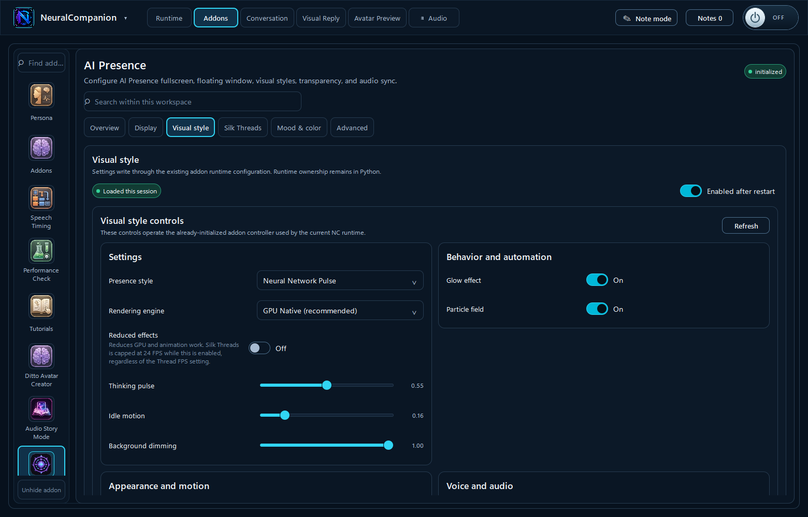

# AI Presence and Companion Orb

AI Presence and Companion Orb are two optional visual addons. They make the
desktop experience more expressive, but neither is a sensory source by itself.

- **AI Presence** is a fullscreen or floating visualizer. It reacts to NC's state,
  speech, optional desktop audio, and mood.
- **Companion Orb** is a small desktop overlay with selectable visual styles,
  movement, a sensory target, watches, and optional eye tracking.

Showing either overlay does not grant permission to capture the desktop. Vision
capture, background reviews, and companion watches have separate controls.

## AI Presence

### Activate it

Open **Addons > AI Presence**. If the addon is not loaded, enable it in the Addon
Manager and restart when requested.

The Overview page shows the **AI Presence activation** card and a status chip:

- **PRESENCE OFF** — the master switch is off.
- **ENABLED · HIDDEN** — the switch is on, but the screen mode is **Off**.
- **ACTIVE** — the addon is loaded, enabled, and has a visible screen mode.
- **ADDON NOT LOADED** — install or enable the addon before using these controls.

Use the **Enable AI Presence** switch to enable the visualizer. A visible screen
mode is also required. The three main actions are:

- **Start and show Presence** — enables Presence and selects **Floating Window**
  if the current mode is **Off**.
- **Preview fullscreen** — opens a fullscreen preview of the current style.
- **Open floating window** — enables Presence and shows it as a floating window.

**Center Floating Window** is available on the Display page if the floating
window is off-screen or misplaced. Choosing **Screen mode > Off** hides AI
Presence without unloading the addon.

### Choose a visual style

Fresh installations are configured for **Living Voice Thread / Silk ribbon**
with **Breathing ribbon** motion, a blue/orange/green custom palette, and the
current tuned appearance in the built-in **Default** preset. General Presence
controls are configured too: GPU Native rendering, a 120 FPS thread target,
90 Hz audio refresh, desktop-audio reactivity, and full effects. AI Presence
stays off until you enable it.

The default display is **Floating Window**, transparent and always on top,
with window size/position remembered, click-through enabled, and right-drag
movement enabled. Floating opacity is **1.00**; fullscreen opacity is **0.72**.
**Cover entire screen** and **Space exits fullscreen** are on. Fresh installs
use native window placement rather than coordinates from another machine.
Existing saved settings and custom presets keep their own values.

The current native styles are:

| Style | Character |
| --- | --- |
| **Neural Network Pulse** | A pulsing neural field driven by state, voice, music, and mood. The activation card labels it **Neural Pulse**. |
| **Living Voice Thread** | GPU-rendered voice threads with detailed motion, color, physics, and placement controls. |
| **Silk Drift** | A calmer flowing style with less detailed thread motion. |

**Activate Silk Threads · Recommended** is a guided shortcut. It enables
Presence, selects the **Living Voice Thread** style and **GPU Native** renderer,
sets the **Silk ribbon** variation, and enables NC-voice colors. It does not reset
your existing thread tuning.

**Presence style** in **Visual style** selects the same three styles.
**Rendering engine** offers **GPU Native (recommended)** or **Legacy Canvas
(compatibility)** for older machines or comparison.

### Display and window behavior

**Screen mode** controls where Presence appears:

- **Off** — hidden.
- **Fullscreen** — covers the display while AI Presence is enabled, including
  when NC is idle. Desktop audio can drive the visualization without an AI reply.
- **Floating Window** — a movable desktop window.
- **Both** — show both forms where supported.

**Cover entire screen** controls the fullscreen overlay's size. On covers the
whole screen; off covers only NC's window. It is available only for **Fullscreen**
or **Both** while the visualizer runs in the same process as NC. If it is disabled,
check **Advanced > Run visualizer in a separate process**: fullscreen overlays
in a separate process always cover the whole screen. The saved size choice is
kept when switching modes.
The same explanation is available below the switch and in its hover tooltip.

Fullscreen always passes mouse input through to the desktop and applications
underneath, regardless of the floating-window click-through setting. Clicking
does not dismiss it. This also applies to the fullscreen preview.

Choose **Screen mode > Off** to hide it. **Escape** and the configured **Space
exits fullscreen** behavior work when the visualizer's process receives the key;
they are not system-wide shortcuts. A dismissed fullscreen stays hidden through
idle refreshes; a new AI turn or a new screen-mode choice can show it again.

**Preview fullscreen** runs a temporary demonstration, then restores the previous
display choices automatically. A display-mode change made during the preview is kept.

**Display > Window opacity** provides independent **Fullscreen opacity** and
**Floating window opacity** controls. Each runs from 0 (invisible) to 1 (fully
opaque); either mode can be more or less opaque than the other. Changing one does
not change the other. Existing settings keep their effective opacity until you
adjust these controls. The old shared opacity and floating multiplier remain
compatible with older saved setups, but are no longer shown as separate controls.
The live opacity slider adjusts only the window in which it appears.

**Floating window** groups **Always on top**, **Remember window size and position**,
**Click-through by default**, **Right-click drag moves window**, and **Transparent
background**. Remembering size and position reuses the saved window dimensions and
placement when it opens; otherwise the default placement is used.

On Windows, **Click-through by default** and **Right-click drag moves window**
work together: left clicks reach the application underneath while a right-drag
starting over the visible floating visualizer moves it. That right gesture does
not right-click the application underneath. Right clicks outside the visualizer
remain unchanged. Live controls and mouse physics temporarily accept input so
they remain interactive. Other platforms retain their existing drag behavior.
Appearance and motion controls remain in **Visual style**, without a duplicate
card in Display.

### Audio and Silk Threads

Presence can react to two different audio sources:

- NC voice/TTS drives speaking animation.
- **Sync default output audio** reacts to the computer's default output, such as
  music or video. It is off by default and is independent of NC speech.

**Audio analysis rate** updates the level and spectrum data between 5 and 120
times per second. Higher values react faster but use more CPU. This is not the
audio device sample rate.

The **Silk Threads** page groups presets, thread style, color and glow, audio
reaction, physics, placement, and performance. For a first test:

1. Choose **Balanced**, **Calm**, or **Expressive** under **Animation preset**.
2. Select **Load preset**. Selecting a name alone does not load its tuning.
3. Play one short NC voice reply, then adjust the visible thread controls.
4. Select **Save current**, enter a **Preset name**, and confirm to keep your
   tuning. Saved custom presets appear in **Animation preset**.
5. To remove one, select that custom preset and use **Delete custom**. Built-in
   presets cannot be deleted. Deleting a preset does not undo its current tuning.

Saving again with the same normalized name replaces that custom preset. Use a
new name to keep a separate variant.

**Output reaction target** limits whether desktop audio affects glow, shape, or
the full spectrum. **React to NC voice / TTS** and **React to desktop output**
can be enabled separately. Desktop reaction also needs **Sync default output
audio**; the desktop color switch alone does not start output capture.
**Audio-reactive strand colors** controls the color layer. **Link desktop audio
to main thread controls** lets desktop motion use the main thread tuning;
unlink it to use the desktop-specific motion controls. Start with the link on,
then adjust desktop gain/mix and the noise gate if quiet audio is not visible.
A high noise gate can suppress a quiet signal. **Mouse physics** is an optional
left-drag interaction, not a requirement for voice response.

### Mood and color

Open **Mood & color** and choose **Automatic**, **Manual**, or **Off**. Automatic
uses the companion's current mood; Manual keeps a selected mood; Off leaves mood
color out of the animation. **Story mood override** and **Persona mood override**
let story or persona state influence the palette when enabled.

**Reduced effects** lowers animation work. When enabled, Silk Threads is capped
at 24 FPS even if a higher thread FPS is selected. Visible output is also limited
by the monitor's refresh rate.

To stop Presence, set **Screen mode** to **Off** or turn off the master Presence
switch. The addon can remain loaded while the visualizer is hidden.

## Companion Orb

The Orb is a lightweight desktop presence. It can show NC's state, react to
speech, move around its home position, open a small action rail, and provide a
target for optional vision work.

### Activate it

Open **Addons > Companion Orb**. If the addon is not loaded, enable it in the
Addon Manager and restart when requested.

The Overview page shows **Companion Orb activation** with a status chip:

- **ORB OFF** — the master switch is off.
- **ENABLED · HIDDEN** — the switch is on, but visibility is **Off**.
- **ACTIVE · …** — the Orb is running in the named visibility mode.

Use **Start Companion Orb** or **Start and show Orb**. If the visibility mode is
**Off**, starting the Orb automatically selects **Docked only**.

**Visibility mode** options are:

- **Off** — keep the Orb hidden.
- **Docked only** — keep it at its home position.
- **During interaction only** — show it while NC is listening, thinking, or
  speaking.
- **Always visible** — keep it visible until disabled.

If the Orb is running but not visible, **Bring Orb into view** restores it.
**Reset position** returns it to its configured home position.

### Choose what the Orb can see

Vision work needs a target. On **Addons → Companion Orb → Overview**, use
**Choose desktop target** or **Placement Mode**, then choose the capture scope
in the **Companion Orb** setup card:

- **Window under Orb**
- **Region around Orb**
- **Entire screen**

Left-drag selects a region; right-drag selects a window. Right-drop on the
desktop background selects that screen, not every monitor. Region size can be
adjusted from the Orb menu. All watches share the current target.

A target in the Orb and the separate **Screen** source in Vision Sensors are not
the same selection. Correct the target you actually intend to use.

### Showing is not watching

The Orb can be visible without capturing anything. Likewise, enabling
**Companion Orb** or choosing a target does not start background watching.

To set up a watch:

1. Confirm the Orb is running and its target contains the subject you want to
   observe.
2. Open **Runtime → Vision Sensors → Companion Orb Target → Setup**. In
   **Vision model**, choose a vision-capable model and verify its availability.
   **Vision settings** on the Orb Overview card opens this source settings page.
3. Confirm that **Companion Orb Target** is the intended sensory source.
4. Return to **Addons → Companion Orb → Overview** and use **Enable watching…**
   when the setup card offers it. Review the displayed capture target,
   image recipients, possible remote/API use, and any other enabled sensors that
   share background permissions. This action adds the Orb target source and the
   shared background permissions shown in the consent summary.
5. Confirm only if the consent summary matches your intent. **Cancel** changes
   nothing.
6. Ask for a bounded task, such as "Tell me when the visible video title
   changes." Ordinary chat and the helper both work.

A watch is listed with its **Registered instruction**, **Latest check**, and
**Latest observation**. A registered watch is not necessarily running. If the
target disappears or capture fails, the watch pauses instead of widening to the
whole screen. Remove an individual watch with **X** or **Stop watch**. Hiding the
Orb is a separate action and does not by itself remove watches.

For sensory behavior, open **Runtime → Vision Sensors → Companion Orb
Target**. Its tabs are **Setup**, **Watches**, **Behavior**, **Prompts**,
**Desktop map**, **Actions**, and **Advanced**:

- **Watches** lists requested ongoing tasks; watches also appear on the Orb
  addon's Overview page.
- **Behavior** contains Orb personality rules and response triggers.
- **Prompts** contains reply styles, the supervisor prompt, and source guidance.
- **Desktop map** and **Actions** contain separate movement, map, and click
  options. Start with one watch before enabling broader rules.

In this source's **Setup → What the Orb can see** card, **Use Companion Orb
Target** registers the Orb as the sensory source; **Run background check-ins**
lets that source participate in background review. Neither control chooses a
capture target or creates a conversational watch for you. The Addons rail keeps
visual/movement settings; its former **Awareness** and **Vision & Actions**
sections are presented through Vision Sensors.

### Visual style, motion, and voice

The **Companion Orb Visual Style** selector changes appearance without changing
capture, voice sync, movement, or reply behavior. Current styles include:

**Neural Spark Orb**, **Silk Drift**, **Aurora Glass Orb**,
**Prismatic Pulse Ring**, **Aether Wisp Orb**, **Celestial Firetrail Orb**,
**Quantum Halo Orb**, **Event Horizon Orb**, **Holographic Iris Orb**,
**Synaptic Bloom Orb**, **Liquid Core Orb**, and **Void Prism Orb**.

**Movement enabled** adds a subtle drift around the home position. **Movement
Range** controls how far it wanders and **Movement Speed** how quickly it moves.
**Reset Position** returns it to the selected corner.

**Orb voice sync** is independent of AI Presence audio. **Orb Sync Rate** controls
only the Orb's voice-level update rate. **Falling particles**, **Drip Particles**,
**Drip Lifetime**, **Orb Particles**, **Smoke Intensity**, **Orb Glow**, and
**Orb Voice Reactivity** are appearance controls, not sensory permissions.

### Eye tracking and actions

The Orb supports optional Tobii eye tracking. **Dwell Focus**, **Continuous
Follow**, **Manual Only**, and **Off** are separate from the Orb's visibility
mode. See the [Tobii Eye Tracker 4C setup](../manual/companion-orb-tobii-4c.md)
for hardware, calibration, and recovery details.

Two safety-related defaults are worth knowing:

- **Enable Action gaze button** is off by default. While off, the Action button
  is visibly disabled and NC performs no UI Automation scan or click-target
  capture for it.
- **Allow blink and eye commands** is on by default. This permission only allows
  the gestures; blink-click mode itself still starts off and must be armed. Turn
  the permission off to disable all blink and eye commands.

The optional long-gaze radial menu is also off by default. When enabled, a stable
long gaze opens a gaze-selectable menu for actions such as **React**,
**Describe**, **Explain**, **Summarize**, **Read text**, **Voice**,
**Reply style**, **Chat**, **Scrolling**, and, if explicitly allowed,
**Action**.

### Hotkeys

Default app-local Orb hotkeys:

- `Ctrl+Alt+O` — toggle the Orb.
- `Ctrl+Alt+Shift+O` — toggle edit mode.
- `Ctrl+Alt+P` — toggle placement mode.
- `Ctrl+Alt+Backspace` — clear the selected target.
- `Ctrl+Alt+C` — toggle click-through.
- `Ctrl+Alt+R` — reset position.
- `Ctrl+Alt+G` — request a comment at the latest gaze point.
- `Esc` — leave edit/placement mode, or hide the visible Orb.

Hotkeys are ignored while typing in a text field. You can change them in the Orb
settings, where **hotkeys enabled** is the master switch.

### Orb action rail

Right-click the desktop Orb to open its compact icon rail. Hover an icon for its
action, or use the bottom arrow to expand labels. **Pin** keeps the menu
available. Drag the center circle to reposition the rail; double-click it to show
or minimize the main NC window. The expanded menu includes an ON/OFF runtime
control and shortcuts to floating Conversation and MuseTalk windows.

## Limitations and safe use

- AI Presence is decorative. It does not perform vision capture or grant watch
  permissions.
- The Orb can be visible without capturing, and a target can exist without an
  active watch. Treat those states separately.
- Fullscreen Presence, click-through, and the Orb overlay can interfere with
  desktop interaction. Know the matching hide, clear-target, and click-through
  keys before enabling them.
- Eye tracking depends on the tracker, Tobii runtime, calibration, and selected
  display. It is not a general mouse replacement for every application.
- Accessibility-based Orb actions cannot see every application, cannot inspect
  an elevated application from a non-elevated process, and are unreliable on
  custom-rendered surfaces.
- Mouse and gaze state stay local, but a watch's captured images follow the
  configured vision-model route and may go to a remote provider. Removing a watch
  or hiding the Orb does not remove the underlying sensory source's permission.

For capture behavior and background permissions, see
[Visual Reply and sensory awareness](../manual/visual-reply-and-sensory.md).
For preparing MuseTalk face-mask output for an external Orb overlay, see
[MuseTalk](../manual/musetalk.md).
