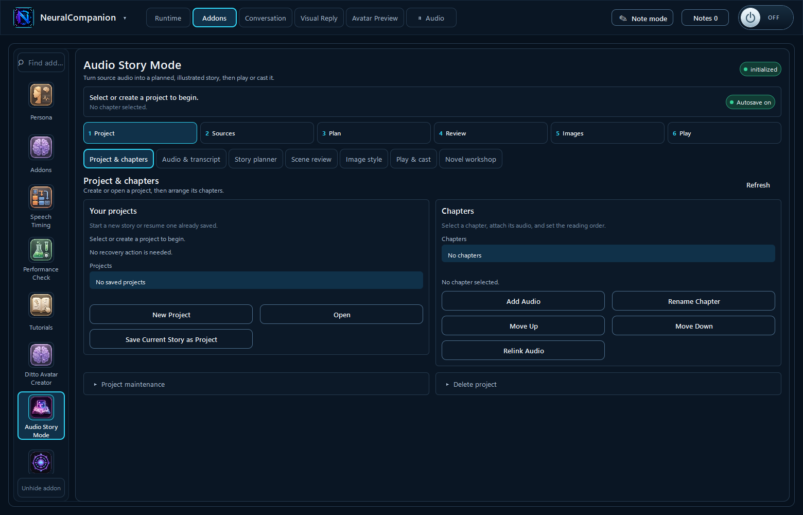

# Audio Story Mode

**Audio Story Mode** turns source material into a planned, illustrated story
project. It can import an audiobook or other audio, adapt a chatlog into a novel,
or narrate Markdown chapters, then synchronize generated images with the story
timeline and play or cast the result.

Audio Story Mode is present but still under active construction. Some workflows
may fail or be incomplete. Build a small project first and verify each stage
before starting a long book.

## Before You Start

Audio Story Mode is included but disabled by default on fresh installations.

- Enable **Audio Story Mode** in the Addons workspace and restart NC if
  requested.
- Install `ffmpeg` and `ffprobe`, or use the installer-provided tools. Audio
  import and media utilities depend on both.
- Prepare a local Whisper transcription route for audio sources.
- Have a configured chat provider if you use an LLM scene planner or novel
  adaptation.
- Have a configured Visual Reply provider for final images. Scene planning and
  image generation can use different providers.
- Keep source files in a stable location. A moved source needs **Relink Audio**.

Reading a guide does not import, transcribe, generate, or cast anything.

## Setup Versus Activation

Open **Addons → Audio Story Mode** to reach this workspace.

1. **Addon setup:** enable Audio Story Mode and restart if requested.
2. **Project setup:** create/open a project, add an audio or text source, and
   select the chapter you intend to work on.
3. **Preparation:** transcribe/import, build the scene plan, review scenes, and
   configure image style.
4. **Activation:** select **Play** in **Play & cast** for a short local test.
   Optional **Find Casts → Cast To** is a separate output action.

Saving a project does not start playback. Generating images does not start
playback either.

## Create A Project And Chapters

In **Project & chapters**:

- **New Project** starts a project.
- **Open** loads a saved project.
- **Save Current Story as Project** migrates the current legacy (pre-project)
  story into a project. It is available only when no project is open and a
  migratable story exists.
- **Rename** changes the saved project name.
- **Close** unloads the current project without deleting it.
- **Add Audio** attaches chapter audio.
- **Rename Chapter**, **Move Up**, and **Move Down** arrange the reading order.
- **Archive** removes a chapter from the reading order without deleting its
  stored media; **Restore** puts it back at the end of the order.
- **Relink Audio** repairs a moved source.
- **Delete** permanently removes the selected project and its generated files.
  Original source audio files are kept.

Select the chapter before editing or playing it. Chapter order is meaningful:
the timeline and planned images follow it.

## Route 1: Audio And Transcript

1. Open **Audio & transcript**.
2. Use **Import Audio Files** and arrange the order.
3. Test a short **Selected Range** before transcribing a whole book.
4. Select **Transcribe Audio**.

Transcription runs local Whisper and builds the story timeline. Wait for
progress to finish, then read the actual transcript in **Scene review**. The
console's **Copy** and **Clear** buttons affect the activity log, not the
transcript.

Long audio can take a long time and consume local GPU/CPU resources. If
transcription fails, check `ffmpeg`/`ffprobe`, the source file, and the Whisper
runtime before retrying the whole project.

## Route 2: Chatlog Or Markdown Novel

Open **Novel workshop** to choose:

- **Choose Chatlog JSON** for a conversation export.
- **Choose Markdown** for prose with chapter headings.
- **New Novel Project** for a project that will receive one of those sources.

For a chatlog, inspect the detected messages before **Import Confirmed Source**.
If detection is wrong, map the message collection, speaker field, text field,
and optional role, timestamp, or thread fields, then select **Inspect with this
mapping again**. Confirm only when the preview matches the intended source.

For Markdown, headings become narration chapters. You can proceed to chapter
narration without building a chatlog adaptation.

### Adapt A Chatlog Into Prose

After importing and confirming the source:

1. Choose an **Adaptation style** and enter **Novel instructions**.
2. Select **Build Story Map**, then **Build Outline**.
3. Review chapter and scene order. Use **Move Up**, **Move Down**, **Split
   Selected**, or **Merge with Next** as needed.
4. Select **Save Outline**.
5. Select **Approve and Generate**.
6. Use **Retry Selected Scene** to repair a failed scene without regenerating the
   entire novel.

This is a generated adaptation, not a verbatim transcript. Review the prose
before narrating or publishing it.

## Plan The Visual Story

In **Story planner**, set the image cadence. Optionally enable **Use LLM scene
planner**, choose its **Planner provider** and **Planner model**, and select
**Apply Planner Changes**. Wait for the saved state.

**Scene Only** keeps per-scene planning. **Story Bible** keeps character,
location, prop, and style memory across the story. Start with the default depth
and a short source before processing a long project.

In **Image style**, choose a visual direction such as **Cartoon**, select **Apply
Style Changes**, and confirm the saved state. Final images use the active
**Runtime → Runtime Session → Visual reply** provider, model, and workflow; the visual style pass
does not change the provider for you. Provider-specific xAI controls apply only
to xAI/Grok.

Image generation can be slow and can cost money. Keep generate-ahead small for
the first run.

## Review Scenes

Open **Scene review** to read the transcript and inspect the current scene.
Correct **Image focus** or **Avoid** fields, then use **Apply image focus** or
**Apply avoid list**. Optional controls such as **Pin Location**, **Force Fresh
Scene**, and **Force Continuation** override a wrong scene boundary.

Review the next generated image to confirm that a correction worked. Scene
edits affect later visual continuity; they do not rewrite the source audio.

## Play And Cast

Open **Play & cast** and select **Play** for a short local test. Audio should
advance and images should follow the story timeline. **Pause** or **Stop** before
changing playback settings.

**Voice rendering** shows buffer progress and offers **Retry** for failed speech.
Long TTS work may need time to get ahead of playback.

For Chromecast:

1. Select **Find Casts**.
2. Choose a device.
3. Select **Cast To**.
4. Inspect the cast status.
5. Select **Stop Cast** when finished.

If Chromecast support is missing, NC may offer to install its optional
PyChromecast/Zeroconf dependencies after confirmation. A firewall prompt may be
needed for the local visual stream. **LAN sharing** is optional and exposes the
visual stream to other devices on the local network; enable it only on a trusted
network.

## Resume And Recovery

Return to **Project & chapters**, select the project, and choose **Open**.
Verify the chapter and recovery status before **Resume All** or **Retry
Selected** in **Project maintenance**.

- **Relink Audio** repairs a moved audio file.
- **Close** unloads a project without deleting it. **Delete** removes the
  project and generated files but keeps the original source audio.
- **Archived chapters** stay stored but leave the reading order until restored.
- Story Bible continuity belongs to this story project.
- Chapter order is preserved with the project.
- The addon does not edit the companion's normal conversation memories.
- Partial or failed generations may need an explicit retry; do not assume every
  stage is idempotent.

Each saved project keeps a backup copy of its manifest. If **Open** finds the
primary manifest unreadable, NC opens the last valid backup and repairs the
stored project in the background; the status reports the recovery. If both the
primary and its backup are unreadable, NC reports the project as corrupt and
preserves the files instead of silently replacing them.

In **Story Bible** mode, a malformed or unsupported saved story-memory file also
pauses Story Bible updates. NC names the affected file in the status and
activity log rather than overwriting it. Restore that file before continuing; a
recovery error is not an empty Story Bible.

## Troubleshooting

| Symptom | Check |
| --- | --- |
| Import or transcription fails | Verify `ffmpeg`, `ffprobe`, the source path, and the local Whisper runtime |
| No transcript | Read the activity log; the console **Clear** button only clears the log |
| Planner changes do not apply | Select **Apply Planner Changes** and wait for the saved confirmation |
| Images do not match the story | Review **Scene review**, Image focus/Avoid, Story Bible, and the active Visual Reply provider |
| Playback has no images | Confirm the scene plan and image provider, then test one short range |
| Chromecast is not found | Check that the PC and device share a network, install the optional support if offered, and allow the firewall prompt |
| A source moved | Use **Relink Audio** or reopen the project from the correct location |
| Project opens from a backup | NC recovered the last valid project manifest and is repairing storage. Read the status and avoid editing until it settles |
| Project is reported corrupt | Both the project manifest and its backup are unreadable. Preserve the project folder and restore a backup copy; do not delete the source audio |
| Story Bible updates pause and name a file | Restore that story-memory file; NC will not overwrite the damaged file |
| Project resumes incorrectly | Verify the selected chapter and recovery status before **Resume All** |

## Current Limits

- Audio Story Mode is still under active construction. Some controls and
  workflows may fail or behave differently from a finished feature; test a small
  source first.
- Final image generation depends on a separately configured Visual Reply
  provider and can incur cost.
- Audio transcription needs local Whisper and working FFmpeg tools.
- The story planner and image provider are independent; changing one does not
  change the other.
- Chromecast and LAN sharing are optional network features and may be blocked by
  the local firewall or network policy.
- Backup recovery restores the stored project, not your original source files or
  a deleted project.
- This addon creates a story project, not a new companion memory, Persona, voice,
  or avatar.

## Related Guides

- [Multi Persona Roleplay](roleplay.md)
- [Local Room](local_room.md)
- [Buddy Chat](buddy_chat.md)
- [Addon setup and index](../manual/addons.md)
