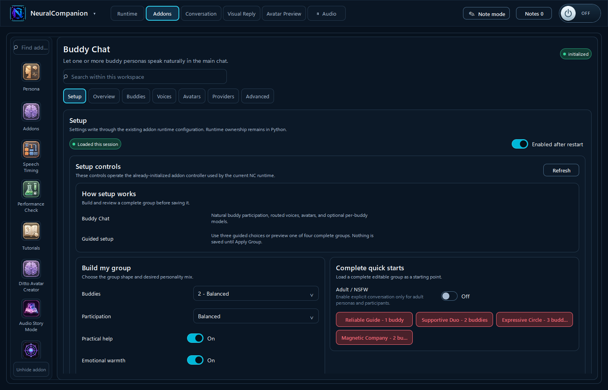

# Buddy Chat

Buddy Chat lets one or more buddy Personas participate naturally in the
**normal Main Chat**. It is a conversation layer, not a separate room. Replies
still use the main chat session, and the selected buddies can share the reply or
speak in turn depending on the participation settings.

## Buddy Chat Is Not A Room

Use Buddy Chat when you want several distinct voices and personalities inside
the ordinary conversation. Use [Local Room](local_room.md) for a separate
moderated group that has its own transcript and turn-taking. Use
[Multi Persona Roleplay](roleplay.md) for an isolated story feed with a narrator
and **Start Play**.

## Setup Versus Activation

Open **Addons → Buddy Chat**. The workspace has **Setup**, **Overview**,
**Buddies**, **Voices**, **Avatars**, **Providers**, and **Advanced** sections.

1. **Addon setup:** enable **Buddy Chat** in the Addons workspace and restart if
   the toggle says **Enabled after restart**.
2. **Group setup:** build or load a group in the addon's **Setup** tab. A staged
   preview is not saved until **Apply group**.
3. **Runtime activation:** open **Overview**, turn on **Enable Buddy Chat**, and
   select **Save**. This is separate from the Addon Manager's next-launch toggle.

The status chip in the addon workspace can say **Loaded this session** while
Buddy Chat itself is still disabled in Overview.

## Build A Group

Open **Setup** and either:

- choose a complete quick start such as **Reliable Guide**, **Supportive Duo**,
  **Expressive Circle**, or **Magnetic Company**, or
- use **Build my group** to choose the buddy count, participation style, and
  personality mix, then select **Preview guided group**.

Review the staged names, roles, descriptions, prompts, speaking styles, and
participation values. **Apply group** commits the staged setup; **Cancel preview**
leaves the current saved group unchanged. **Undo last setup** is available after
an applied setup.

### Refine a staged group

Create a preview first, then use **Optional LLM refinement** in **Setup**:

1. Choose **Refine scope**: **Entire group**, **One buddy**, or **One field**.
2. For the last two scopes, select **Refine persona**. For **One field**, also
   select **Refine field**; that selector does not limit **One buddy**.
3. Enter a concrete **Refinement instruction**, such as “Make this buddy's
   speaking style shorter and more curious.”
4. Select **Refine with LLM** and read **Refinement result**. Use
   **Cancel refinement** to stop an unwanted request.
5. Inspect the revised staged fields and changes before **Apply group**.

Refinement uses the configured LLM route. It edits the preview rather than
silently applying a saved group. It preserves buddy IDs and does not configure
providers, credentials, voices, or avatars. If a model returns an invalid or
out-of-scope response, read the result and retry with a narrower instruction;
the failed response is not a new saved group.

## Edit Buddies

Open **Buddies** to review each buddy's active switch, name, role, description,
speaking style, and system prompt. A deactivated buddy keeps its configuration
for later use. Use **Save** in **Overview** after deliberate edits.

Keep roles distinct enough to be useful. For example, one buddy can explain a
single idea at a time while another asks short follow-up questions. Adult/NSFW
mode, when present, is opt-in and requires confirmation; it is not required for
normal Buddy Chat.

## Voices

Open **Voices** to enable **Use voice sample** for a buddy and choose a local
audio reference. Voice routing depends on:

- a desktop TTS backend that supports reference audio,
- a saved, valid reference file,
- and recognized buddy or speaker segments in the reply.

Assigning different samples does not by itself prove the route. Test a short
exchange and confirm that the intended buddy voice is actually used. Typing a
buddy name in a prompt is not a routing test.

For creating reusable references, use [Voice Studio](voice_studio.md). Voice
Studio saves a WAV to its library; you still assign it in the Persona or buddy
voice settings.

## Language Providers

**Overview → LLM provider mode** offers:

- **Use Main LLM Runtime** — the recommended, simplest first test. Buddies use
  the active Main Chat provider/model.
- **Use Buddy Provider** — a shared provider configured in **Providers**.
- **Use Per-Persona Providers** — individual provider/model settings per buddy.

Provider overrides need valid models, endpoints, and credentials. Use
**Refresh shared models** or **Test Buddy provider** where offered, then verify
one ordinary reply before adding more complexity.

## Activate And Tune

In **Overview**:

- **Enable Buddy Chat** turns the layer on for normal chat.
- **Reply mode** defaults to **Natural main conversation - recommended**.
  **Direct Buddy-generated replies - advanced** changes how replies are
  produced.
- **Max buddies per reply** limits how many buddies can contribute.
- **Force buddy every N replies** can keep a quieter cast involved.
- **Show active persona window** is optional; the active Persona is already
  represented in the Conversation workspace.

Select **Save** after changes. Then send a normal message such as:

> Teacher, explain how a rainbow forms; beginner, ask one useful question.

Inspect who spoke, whether the reply still fits the main conversation, and
whether the response was generated once rather than as several independent
turns.

## Avatars

**Avatars** contains per-buddy image and generation controls. Avatar generation
requires a configured Visual Reply provider and may consume provider credits.
Use a plain text reply first; enable avatar generation only after the group and
voice routing are working.

## Prompt Layers And Conflicts

**Setup → Shared prompt layers** holds the shared Buddy Chat override and the
normal and Adult/NSFW conversation prompts. **Advanced** holds **Override main
persona instructions while Buddy Chat is enabled**, **Use recommended override**,
and the editable **Buddy system override** prompt. Use the override when the
single active Persona's instructions are suppressing the buddy cast. Review the
shared layers if the buddies sound too similar or one buddy dominates.

These settings change prompts, not provider behavior or the main chat history.
Keep a working configuration saved before experimenting.

## Troubleshooting

| Symptom | Check |
| --- | --- |
| Buddy Chat tab is missing | Enable the addon in Addons and restart NC if requested |
| Group setup disappears | A staged preview is only saved by **Apply group** |
| No buddies speak | **Enable Buddy Chat** and **Save**; check each buddy's active switch, **Max buddies per reply**, and **Force buddy every N replies** |
| One Persona dominates | Review **Override main persona instructions**, **Buddy system override**, shared prompt layers, and buddy participation values |
| Voices do not change | Confirm a reference-capable TTS backend, valid samples, and recognized buddy segments; test a short reply |
| Refinement does not change the saved group | Build a staged preview, choose the scope and buddy/field, read **Refinement result**, review the proposed changes, then **Apply group** |
| Provider override fails | Validate the shared or per-persona provider, model ID, endpoint, and credentials in **Providers** |

## Current Limits

- Buddy Chat uses the normal Main Chat runtime, not a separate room or memory
  store.
- It does not load multiple TTS backends. Per-buddy voices require the active
  backend to support reference audio.
- Provider overrides can use different models, but they do not create a
  separate parallel conversation for each buddy.
- Avatar generation depends on Visual Reply configuration and provider cost.
- The quality of a generated group depends on the model's ability to follow
  speaker and participation instructions; it is not deterministic.

## Related Guides

- [Local Room](local_room.md)
- [Multi Persona Roleplay](roleplay.md)
- [Voice Studio](voice_studio.md)
- [Addon setup and index](../manual/addons.md)
