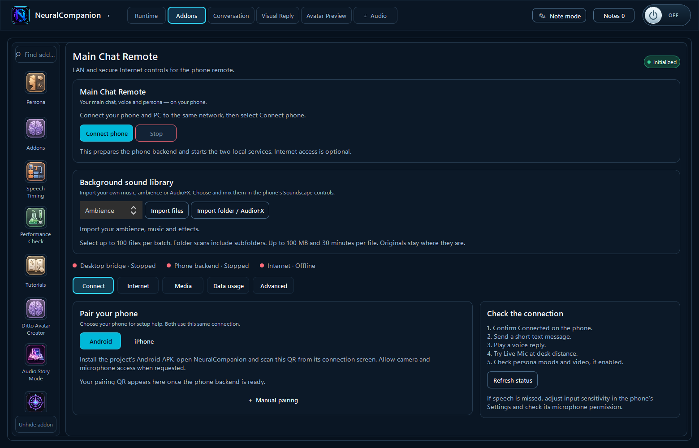

# Main Chat Remote

Main Chat Remote turns a phone into the screen, microphone, and speaker for the
**real desktop Main Chat**. The desktop still owns the conversation, active
Persona, model, speech synthesis, Visual Replies, and avatar. The phone is not a
second AI runtime and does not have a separate chat history.

## Phone Build Availability

The desktop 0.5.0 source release does not include a new signed Android download.
It will follow separately after signing and physical-phone testing. The
existing public alpha APK remains available as a legacy download; compatibility
with desktop 0.5.0 has not been validated. The setup instructions below require
a matching native phone build and apply to maintainers building and testing the
included source, or to a later supported phone release.

## Before You Begin

- Enable **Main Chat Remote** in the Addons workspace and restart Neural
  Companion if the toggle says **Enabled after restart**.
- Install a **native NC phone build**. Install the project's Android APK, or the
  purpose-built iPhone app. **Expo Go is not a supported current remote build: it
  cannot load the native WebRTC module needed for Internet mode and lacks the
  current native phone audio/media modules.**
- Have a working desktop chat provider and TTS configuration.
- For the first LAN test, keep the phone and PC on the same local network.
- For Internet use, also read
  [Secure Internet Setup](main_chat_remote_internet_setup.md).

The phone build and desktop build should match. Older APKs can keep working over
LAN while lacking newer relay, media, or avatar features.

## Setup Versus Activation

| Stage | Action | What it proves |
| --- | --- | --- |
| **Addon setup** | Enable Main Chat Remote and restart if requested | The addon can load |
| **Service setup** | **Connect phone** prepares the desktop bridge and phone backend | The local services are ready |
| **Pairing** | Scan the QR in the native app and tap Connect on the phone | The phone is paired and connected |
| **Runtime activation** | Select the desktop provider/model and **Initialize NC** | Chat and TTS can actually run |
| **Internet activation** | Sign in to the same NC Relay account and open a peer | The phone can reach the desktop away from home |

A green **Phone backend · Ready** indicator means the backend is available. It
does not mean a phone has connected. Likewise, an Internet account can be signed
in, and the desktop can be online, while no usable peer exists.

## LAN Connection

1. Open **Main Chat Remote → Connect**.
2. Select **Connect phone**. Wait for the **Desktop bridge** and **Phone backend**
   statuses to become ready.
3. Choose **Android** or **iPhone** for the matching setup note.
4. In the native app, scan the displayed QR from its connection screen. Use
   **Manual pairing** or **Copy setup link** only when scanning is not practical.
5. Tap **Connect** on the phone.
6. Confirm the phone says **Connected**, then send a short text message and play
   a short voice reply.

The first service start may install or prepare local backend dependencies. That
is part of setup, not chat activation. Pairing codes and setup links are
credentials for your LAN session; do not post them.

### If the phone and PC are not on the same LAN

Use Internet mode or move the phone back to the LAN. Do not expose the LAN
backend or the NC loopback bridge directly to the internet as a shortcut. The
LAN backend normally listens on port `8777` and the NC bridge on loopback port
`8776`; these are defaults, not values to publish. Internet control requests go directly to the desktop bridge; some audio/avatar
streaming endpoints also use the local phone backend.

## Internet Connection

Internet mode is optional and uses **NC Relay**. The desktop and phone sign into
the **same verified account**, then establish an encrypted WebRTC peer. It does
not require DDNS, a user-managed certificate, or an inbound port forward.

1. Open **Main Chat Remote → Internet**.
2. If prompted, select **Prepare Internet runtime**.
3. Create or sign into the verified NC Relay account.
4. Wait for **Desktop online**; successful sign-in connects automatically.
   If already signed in but disconnected, use **Connect** when shown.
5. In the phone's **NC Relay · Internet** area, sign into the same account and
   select **Connect Internet**.
6. Wait for the active peer connection, then send a short test message.

NC starts with Internet offline; a saved account does not reconnect automatically.
Use **Connect** to reuse the saved sign-in, or **Sign in** for a different account.
The relay worker runs while connecting, online waiting for a phone, or serving an
Internet phone session. **Disconnect** closes those sessions and stops the worker
without signing out. Account/setup actions can briefly start it while they work.
**Connecting**, **Working**, and **Disconnecting** describe these transitions;
**Offline** means the relay worker has stopped.

**Try direct connection using router port mapping** is off by default. When it is
on, NC asks a compatible router for temporary UDP mappings through PCP, NAT-PMP,
or UPnP and still keeps TURN as fallback. Browsers are unaffected, and no manual
inbound port forward is required. Disconnect phones before changing the setting.

The desktop bridge must remain running for phone commands, including starting a
stopped chat engine. The phone backend also serves shared audio/avatar streaming.
Stopping either local service disconnects Internet. Stopping only the chat engine
keeps remote access available so the phone can start it again. **Stop** at the top
of Main Chat Remote disconnects Internet and stops both local services. Internet
**Disconnect** leaves those local services available for LAN use.

The detailed account, verification, replacement, network, and security steps are
in [Secure Internet Setup](main_chat_remote_internet_setup.md).

## Using The Shared Conversation

Phone text and image turns use the desktop's existing Main Chat conversation.
That means:

- A phone message appears in the desktop **Conversation** tab.
- Loading a saved context, switching a Persona, resetting chat, or changing a
  model from the phone can affect the shared desktop session.
- Save a conversation you want to keep before making a destructive change.
- The phone's Pause, Resume, and Stop controls affect shared playback.
- Main Chat Remote is not the Local Room, Buddy Chat, Multi Persona Roleplay, or
  Audio Story runtime. It exposes the normal Main Chat path.

Select the providers in **Runtime**, then use **Initialize NC** and wait for
**NC ready**. If the desktop engine is not initialized, pairing can succeed
while replies do not.

## Phone Speech And Avatars

The phone's speech settings distinguish:

- **Backend HQ**: the desktop performs recognition and speech with its selected
  providers. This is the path for distinct desktop character voice references
  and reference-capable TTS engines.
- **Phone Native** (supported Android builds): recognition and speech happen on
  the phone while the desktop still generates the chat reply. The desktop's
  character voices do not automatically carry over.

Phone-only capabilities depend on the connected native build and the desktop
feature flags. Do not assume an iOS build has every Android feature, especially
background capture and native speech.

### Android animated avatar requirement

The continuous Android MuseTalk avatar path requires **NVIDIA NVENC hardware
H.264 encoding on the desktop**. There is **no CPU fallback**, and Intel Quick
Sync or AMD AMF is not implemented for this path. NVENC is required for both
streamed clips and complete cached idle loops; the path stays at 24 fps. The
phone itself does not need an NVIDIA GPU. This is a video-encoding requirement,
not the separate Continuous Mode reply feature.

`Media → Phone idle animations` is optional silent H.264 caching. When disabled,
idle video is streamed. Cached loops require a compatible updated phone build.

If a GPU error appears, run the FFmpeg and NVENC checks in the
[Internet setup guide](main_chat_remote_internet_setup.md#android-animated-avatar-requirement).

## Audio, Video, And Data Use

- **Audio and video quality** affects LAN and Internet peers. Reconnect the
  phone after changing quality; current speech is not interrupted.
- **Phone idle animations → Cache idle animations on phone** downloads complete
  silent loops once per avatar and quality. Speech remains streamed. Turn it off
  for streamed idle video; use **Clear idle cache on phones** to request removal
  when each phone next connects with caching enabled.
- **Data usage** reports media and application bytes across all phones, plus an
  estimated **Transport extra** from WebRTC transport counters. It is not a
  carrier bill and does not include every header, TURN, signaling, or carrier
  charge.
- **Reset statistics** clears counters without disconnecting phones.

Start with lower video bitrate and resolution on a slow cellular link. The
continuous Android avatar route stays at 24 fps; the general frame-rate control
also serves other media paths. These controls do not change phone-native voice.

## Background Sounds (Soundscape)

**Main Chat Remote → Background sound library** imports music, ambience, and
effect files for the phone's **Soundscape** player. **Import files** accepts
individual files; **Import folder / AudioFX** imports a folder. The import review is paged,
with up to 100 individual file selections per request. The library holds up to
2,000 sounds, and each file may be up to 100 MiB and 30 minutes. The originals stay where they are.

On an updated Android build, **Soundscape** mixes ambience and music layers,
adds effects, and can lower background audio while the assistant speaks. Its
master switch is separate from assistant speech: turning Soundscape off stops
background audio without stopping the reply. The phone reports when the
connected build does not provide Soundscape; iOS builds do not currently expose
this panel.

## Stopping And Reconnecting

- **Stop** disconnects Internet access and stops the phone backend and desktop
  bridge. The NC account stays signed in.
- Stopping remote services does not terminate the normal conversation runtime.
- To reconnect, start the LAN service again, or reconnect the relay and phone
  peer. If the phone reports a stale connection, reconnect it rather than
  repeatedly starting a second backend.
- If the desktop sleeps, goes offline, or changes networks, online presence and
  peer connectivity can fail independently. Wake the PC and reconnect before
  changing account settings.

## Troubleshooting

| Problem | Check |
| --- | --- |
| No QR appears | Select **Connect phone** and wait for the phone backend to become ready |
| Backend ready but no phone connection | Scan the QR in the native app, tap **Connect**, and confirm the phone's own status |
| Phone connected but no reply | Select a working provider/model in **Runtime**, select **Initialize NC**, wait for **NC ready**, and confirm TTS |
| LAN fails on a new network | Use the Internet route, check the PC firewall, or return to the same subnet |
| Internet fails while LAN works | Follow the [Internet troubleshooting](main_chat_remote_internet_setup.md#troubleshooting); confirm verified account, same account on both devices, desktop online, and an active peer |
| Stale layout or media after an update | Install the matching native phone build and reconnect |
| GPU/H.264 error on Android avatar | Verify NVENC with FFmpeg and free a busy encoder session; there is no CPU fallback |
| No Soundscape controls | Connect an updated Android build; iOS and older APKs do not expose Soundscape |

## Current Limits

- A native build is required; Expo Go is not supported for current remote media.
- The PC must be running, awake, and able to reach its configured providers.
- LAN and Internet are two routes to one desktop session, not two independent
  chat histories.
- Internet mode depends on NC Relay and, when a direct path fails, TURN.
- Phone features vary by native build and platform. The remote does not make an
  unsupported desktop feature appear on the phone.
- Animated Android avatar output requires desktop NVIDIA NVENC.
- The Soundscape player currently requires an updated Android build.

## Related Guides

- [Main Chat Remote: Secure Internet Setup](main_chat_remote_internet_setup.md)
- [Phone connection diagnostics](../PHONE-CONNECTION-DIAGNOSTICS.md)
- [Phone chat-character library](../CHAT-CHARACTER-LIBRARY.md)
- [Local Room](local_room.md)
- [Addon setup and index](../manual/addons.md)
