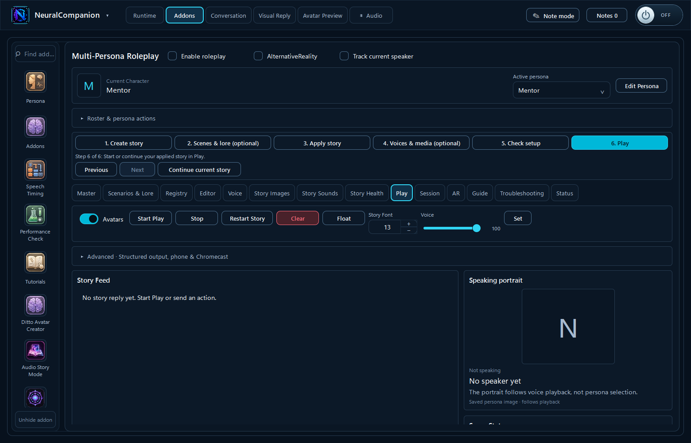

# Multi Persona Roleplay

**Multi Persona Roleplay** adds an isolated story and roleplay workspace. It can
run a single character, a multi-character scene, a narrator-led story, a
tabletop-style game master, or an **AlternativeReality** adventure. Its **Play**
feed has its own story state and memory, separate from ordinary Main Chat.

## Setup Versus Activation

Open **Addons → Roleplay** to reach this workspace. The Addon Manager lists
the manifest name **Multi Persona Roleplay**.

1. **Addon setup:** enable **Multi Persona Roleplay** in the Addons workspace
   and restart NC if requested.
2. **Mode:** in the Roleplay header, enable **Enable roleplay**. Enable
   **AlternativeReality** only when the session uses that directed mode.
3. **Story setup:** create or load a story, review its cast and settings, then
   **Apply Draft** or **Apply story**.
4. **Activation:** select **Start Play**, then send a player action or
   **Continue**. Applying or loading a story leaves the session paused. An
   authored scenario may present its own opening narration.
5. **Continuation:** after **Stop**, use **Start Play** to resume the captured
   session. Use **Restart Story** only when you want a fresh run.

**Status** shows whether roleplay, AlternativeReality, and current-speaker
tracking are enabled. The numbered workflow —
**Create story → Scenes & lore (optional) → Apply story → Voices & media
(optional) → Check setup → Play** — navigates between areas. A highlighted step
means where you are, not that setup is complete.

## Build Or Edit A Persona

Open **Registry** to:

- **Add persona**
- **Duplicate persona**
- import an existing profile where offered

Then use **Editor** to review the name, role, description, system prompt,
speaking style, behavior, memory scope, and tags. Keep regular prompts separate
from optional AlternativeReality prompts; each mode uses the one appropriate to
its session.

A typical first test is one character and one scene before a large cast. Include
only the traits the model needs to stay in character, and review generated text
before treating it as canon.

## Choose A Session Mode

The **Session** tab offers:

- **Single active persona** — one character responds.
- **Multi-character group chat** — the active cast can speak as participants;
  there is no dedicated narrator layer.
- **Narrator + characters** — a narrator plus named character dialogue.
- **RPG / Game Master** — the assistant describes the world and adjudicates
  actions.
- **AlternativeReality** — narrator-led interactive story with scene state,
  pacing, choices, and story audio tags.

**Master's story Mode** is a separate setting from **Session** mode. Check both
when a story behaves differently from the selected session mode.

AlternativeReality can use separate AR persona prompts. If you enable **Use AR
profile in AlternativeReality mode**, review the **AR description** and **AR
system prompt** in the Persona editor. **Fill AR persona prompts** can populate
missing AR fields for the bundled personas without changing their names, voices,
or regular prompts.

## Build A Story In Master

Open **Master** and enter a premise such as:

> A lighthouse keeper and a traveller investigate a signal that should not exist.

Review **Cast generation** and the scene title, location, time/mood, and mood
fields. **Generate Story Setup** uses the current Main Chat model. Optional
refinement can use another configured provider/model without changing the main
chat selection.

For a larger draft, **Refine & build complete draft** prepares a premise, cast,
scenes, and lore in stages. Inspect the editable draft. **Preview only** keeps
the result from replacing the current fields until you choose to use it.

### Apply deliberately

**Apply Draft** opens the apply workflow. Review:

- **Auto-create missing personas**
- **Update matching existing personas**
- voice assignment
- avatar generation
- **Clean-start story memory**

Optional generation can consume provider credits and can overwrite non-empty
prompt fields. Disable the options you do not want. Applying saves the story and
leaves it paused; **Start Play** is the separate activation step.

## Scenes And Lore

**Scenarios & Lore** is an optional authored layer. It can define:

- scenes and scene changes
- lorebooks and pinned facts
- typed variables
- events and authored choices
- cast roles and story fields

Use **Set field** for text edits and **Send to Master Draft** to validate and
copy the editor into the draft. **Reload Master Draft** asks before discarding
unsent editor changes. Sending or saving a draft does not execute actions.

After a story is applied, **Additional controls → Scenario Choices & Progress**
shows the current scene, lore diagnostics, and authored choices. Authored
choices can set a variable, change the scene, or narrate authored text. They are
separate from ordinary generated reply choices.

**Stop** saves scenario progress. **Start Play** resumes it. **Restart Story**
starts fresh, so opening text and effects can run again. A failed one-time event
may offer a separate retry rather than silently repeating.

## Voices

Open **Voice**. Check **Currently editing** and **Follow active persona** before
saving. **Inherit** follows the active main TTS backend; a backend override must
be available and compatible.

Reference samples are supported by some backends only. Current documented
reference routes include Chatterbox and PocketTTS variants; Gemini TTS Preview
does not use voice samples. If the backend does not support reference audio, the
Persona warns and falls back rather than producing a false voice match.

Distinct voices require explicit speaker segments such as `[NARRATOR]` or
`[CHARACTER: Name]`, or supported speaker metadata. Test a short narration and
a short character line before a long story. A single TTS response does not
switch backends per message.

## Story Sounds And Images

**Story Sounds** uses structured cues such as `[AMBIENCE: ...]`, `[MUSIC: ...]`,
`[FX: ...]`, and `[STINGER: ...]`. Matching cue text is removed before speech.
Attach and preview local AudioFX files before relying on them. Imported audio
packs are merged by path and cue ID; the original file is not deleted when an
AudioFX entry is removed from the addon.

**Story Images** uses the separate Visual Reply service. Persona visual profiles
build the prompts, but a configured provider, workflow, or API credentials are
still required. Review automatic generation limits and provider costs before
enabling images for a long session.

## Check Setup Before A Long Story

**Story Health** validates narrator setup, voice files, unsupported backends,
image paths, memory snapshots, Persona links, and AudioFX resources. Use
**Check Story Setup** and read the specific warnings before selecting a repair
button.

**Load Demo if Needed & Check** loads the built-in demo only when no story is
active. Use it intentionally; it changes the active story.

The **Troubleshooting** and **Status** tabs expose effective prompts and voice
routing. They are diagnostic views, not proof that every provider or device is
working.

## Story Memory And Play

Roleplay keeps long memory per loaded story: scene, location, active characters,
recent events, chapter summaries, pinned facts, and retrieved story context.
While **Play** is active, ordinary Main Chat, Buddy Chat, Companion Orb, and
other non-roleplay replies do not advance the roleplay story.

Use the **Story Memory** controls in **Story Health** to review pinned facts and
recent events, delete one wrong event, or reset character or story memory while
keeping pinned facts. Use these destructive actions deliberately.

## Save, Load, And Move A Story

- **Save Story** stores later draft edits to the current story.
- **Load Story** restores that story's saved memory and leaves it paused.
- **Story Library Export** creates a portable `.mprcstory.zip` with selectable
  metadata, cast, memory, images, voices, audio, and settings.
- **Export Story Bundle** creates a compact JSON bundle for story setup and
  diagnostics. It does not carry every copied asset.
- Imported packages are validated and remapped into addon-owned storage.
  Re-importing the same package reuses its story asset folder where possible.

### Delete and recover a story

**Master → Delete Story** removes that saved story, its memory snapshot, and its
authored scenario progress. Linked Persona profiles, voice samples, portraits,
and other saved stories are kept.

NC refuses to delete while Play is active or while queued or running story work
can still write progress. Stop the story, wait for the current work to finish,
then delete it. This prevents a deleted story from being recreated by a late
save.

**Story Health → Restore Last Backup** restores the recovery snapshot NC writes
before **Apply Draft**, a story import, or a built-in template load. It covers
Personas, session and settings, the last draft, and long memory. It does not
undo **Delete Story** and does not repair a damaged story library index.

The Master story list is read from the addon's `stories/index.json`. If that
index is unreadable, NC logs the problem and can show an empty library even
though the individual saved story files still exist; it does not rebuild the
index automatically. Preserve the addon storage and restore the index from a
backup rather than deleting story files.

The play feed is isolated, but it is not a backup of the rest of NC. Save the
normal conversation separately.

## Troubleshooting

| Symptom | Check |
| --- | --- |
| Roleplay tab is missing | Enable the addon in Addons and restart if requested |
| Story is applied but nothing happens | **Apply** leaves the story paused; select **Start Play** |
| No audio | Check the active TTS backend, the Persona's voice toggle, its sample path, and whether the backend supports reference audio |
| Voices change unexpectedly | Open **Status** or **Troubleshooting** and inspect the voice route for explicit speaker labels |
| Images do not generate | Configure Visual Reply first, then check the Persona visual profile and generation limits |
| Story memory feels wrong | Use **Story Health** to inspect or repair, and review **Apply**, **Load**, and **Restart** actions |
| Delete Story is refused | Play is active or story work is still saving. Stop Play, let the current work finish, then retry |
| Saved stories disappeared from the list | The story index may be unreadable. Do not delete story files; preserve addon storage and restore the index from a backup |
| AlternativeReality is too chatty | Try **Slow / Audiobook** pacing and a less frequent interaction setting |
| Imported story has missing assets | Export a package that includes the voice, image, and AudioFX files, then re-import |

## Current Limits

- One TTS backend is active; per-message backend switching is not performed.
- Voices route only on recognized speaker boundaries.
- Visual Replies and avatar images need separate configured providers and may
  cost money.
- Generated story text, pacing, and scene state can need correction. The model
  does not guarantee a perfect narrator or cast.
- **Apply Draft**, **Load Story**, **Restart Story**, and memory resets change
  story state. Review them before selecting.
- **Delete Story** is permanent and is unavailable while the story is playing or
  still saving.
- This guide does not claim that a particular remote phone or avatar automation
  is available; those depend on other configured features.

## Related Guides

- [Local Room](local_room.md)
- [Buddy Chat](buddy_chat.md)
- [Audio Story Mode](audio_story_mode.md)
- [Voice Studio](voice_studio.md)
- [Addon setup and index](../manual/addons.md)
