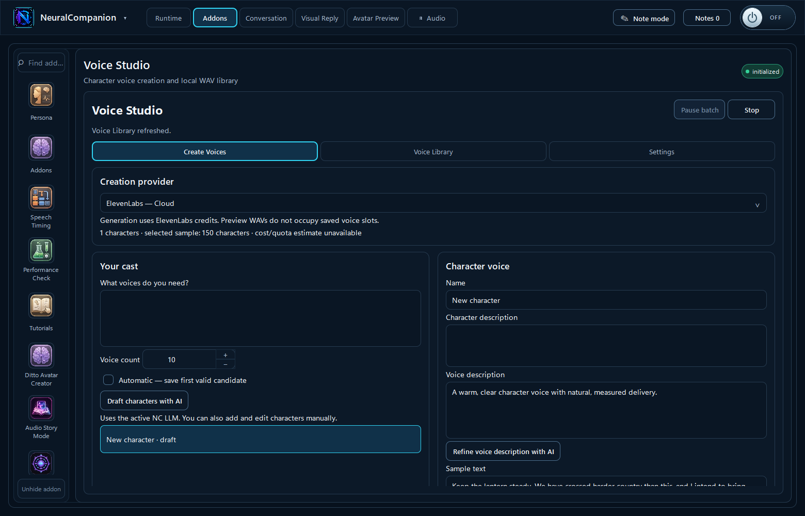

# Voice Studio

Voice Studio creates reusable character voice WAVs and organizes them in a
shared local voice library. It can generate with **ElevenLabs — Cloud** or with a
separate, already-running **VoiceStudio — Local** installation. Saved WAVs can
then be previewed, audited, and assigned to a Persona or other voice slot.

## Setup Versus Activation

Open **Addons → Voice Studio** to reach this workspace.

1. **Addon setup:** enable **Voice Studio** in the Addons workspace and restart
   NC if requested.
2. **Provider setup:** in **Settings**, connect either ElevenLabs or your own
   VoiceStudio installation, then select **Save settings**.
3. **Creation:** in **Create Voices**, generate a candidate and explicitly
   **Save selected WAV**.
4. **Activation:** assign that saved WAV to the intended Persona or buddy and
   use a compatible TTS backend.

The addon can be loaded while neither provider is ready. That is a setup problem,
not a saved voice.

## ElevenLabs Cloud

Open **Settings → ElevenLabs — Cloud**:

- **Use NC ElevenLabs connection** uses the existing NC ElevenLabs configuration.
- **Session-only API key** lets you enter a key for this session without saving
  it. Prefer the NC connection for normal use.
- **Voice Design model** chooses `eleven_ttv_v3` or
  `eleven_multilingual_ttv_v2` for character generation.
- **Longer-dialogue TTS model** is used for the longer-dialogue candidate path.
  It is a free-text model ID; the default is `eleven_multilingual_v2`.
- **Check ElevenLabs connection** reports readiness.

Cloud generation uses ElevenLabs account credits. The UI explicitly notes that a
cost/quota estimate is unavailable, so check your provider account before a
large batch. Preview WAVs do not occupy saved voice slots; the saved library is
separate.

If a request outcome is unknown, do not blindly generate again. Review your
ElevenLabs account and use the explicit retry or resolution control. NC avoids
guessing a voice ID or repeating a paid request automatically.

## VoiceStudio Local

The local option connects to a **separate VoiceStudio installation**:

1. Install, start, and load an engine in that application yourself.
2. In NC **Settings**, confirm the local URL, normally
   `http://127.0.0.1:3900`.
3. Select **Check local connection**.
4. Review the detected engines and whether each is loaded.
5. Select **Save settings**.

NC does not install packages, download models, start the service, or load its
engines. If the status says an engine must be loaded manually, do that in the
VoiceStudio application.

The supported design engines are **OmniVoice** and **VoxCPM2** when the local
service reports them. OmniVoice uses a fixed tag vocabulary, while VoxCPM2 takes
freeform instructions.

OmniVoice accepts only a limited set of gender, age, pitch, whisper, and English
accent tags. Choose one attribute per category; other traits remain in the
character description. English accent tags require English speech. Unsupported
tags are rejected rather than silently dropped. Each local candidate is a
separate generation.

## Create A Voice

In **Create Voices**, choose the **Creation provider** and either add characters
manually or use **Draft characters with AI**.

To draft a cast:

1. Describe **What voices do you need?**
2. Set **Voice count**.
3. Optionally leave **Automatic — save first valid candidate** off so you can
   compare candidates.
4. Select **Draft characters with AI**.
5. Review the generated names, descriptions, voice descriptions, and sample
   text.
6. Select a character, then **Generate selected**.

AI drafting and refinement use the active NC LLM. They do not generate the final
voice.

### Preview and save

When candidates exist:

- **Preview** auditions the selected candidate.
- **Stop** ends the preview or batch.
- **Save selected WAV** stores the validated candidate in the local library.
- **Regenerate / retry** creates another candidate from the same description.
- **Allow retry after checking provider** appears for an unknown outcome after
  you have checked the provider account.

A candidate is not a library voice until it is saved. Saving a new file does not
overwrite an existing one, and filenames are made unique.

**Save cast drafts** stores the editable cast descriptions and prompts. It does
not save audio. **Load saved drafts** restores that editable work, not generated
WAVs. **Remove selected draft** removes the draft character; existing recordings
stay in the library.

## Longer ElevenLabs Dialogue

The **Longer dialogue — ElevenLabs candidate** section can record new text using
a tracked temporary cloud voice. **Generate dialogue and clean up** verifies the
local WAV before deleting that temporary voice. Credits and account operations
still apply.

If cleanup is pending, **Temporary cloud voices** in Settings offers **Retry
cleanup** and, where applicable, an explicit option to discard unsaved dialogue
and delete the tracked voice. Do not delete the temporary voice manually while
an NC save is pending.

## Voice Library

**Voice Library** lists saved local recordings, including WAVs created elsewhere
and shared with Persona.

- Select a voice to inspect its path, duration, source, and metadata.
- **Play original sample** plays the file.
- **Description** and **Notes** are shared with Persona and do not alter the
  recording. Select **Save details**.
- **Remove from library** hides the entry from both libraries but leaves the WAV
  in place so saved Personas keep working. **Show removed voices** and **Restore
  to library** make it visible again.
- **Open voices folder** opens the managed library folder.

Removing a library entry is not the same as deleting the file. Voice Studio keeps
the original so existing Persona assignments do not break silently.

## Audition Your Own Words

In **Voice Library**:

1. Load **Chatterbox** or **Chatterbox Multilingual** in
   **Runtime → Runtime Session → Text-to-speech**.
2. Select a valid saved voice.
3. Enter text under **Try your own words**.
4. Select **Generate test**, then **Play test**.
5. Optionally select **Save test recording…** to store a separate WAV. This
   export creates a new file and refuses to overwrite an existing path.

Audition tests preserve the normal chat voice and stay separate from reference
recordings. Original samples can still be played without the Chatterbox
audition runtime. **Refine with AI** changes test text, not the voice file.

## Assign The Finished Reference

Saving a WAV in Voice Studio does not automatically change the main chat voice or
attach it to a Persona. To use it:

1. Open the intended Persona's **Voice** tab, or the relevant Buddy Chat voice
   setting.
2. Select the saved WAV from the shared library.
3. Preview the original if needed.
4. Select the control that saves the selection to that Persona.
5. Use a TTS backend that supports reference audio.
6. Test one short character reply.

The Persona library can show **Assigned** for a file, but the assignment still
belongs to the Persona's saved voice settings. Saving the library entry alone is
not enough.

## Batch Behavior

- **Pause batch** stops the current batch after the active operation.
- **Stop** cancels the current work; it does not roll back a candidate that was
  already saved.
- **Automatic — save first valid candidate** bypasses manual candidate selection.
  Leave it off when you want to compare takes.
- **Generate all / continue** processes the cast. Review provider cost before a
  large batch.
- A provider or local service error can leave a character in a review or unknown
  state. Inspect that state before retrying.

## Troubleshooting

| Symptom | Check |
| --- | --- |
| ElevenLabs is not ready | Select **Check ElevenLabs connection**, confirm the NC connection or session key, and check account access |
| Local service is not connected | Start the separate VoiceStudio installation, load its engine, confirm the URL, and select **Check local connection** |
| A voice will not generate | Check the provider, character description, sample text, and any per-engine tag limits |
| A test cannot be played later | **Generate test** and **Play test** are session auditions; use **Save test recording…** to keep the result |
| The voice did not change in chat | Assign the WAV to the Persona or buddy, use a reference-capable TTS backend, and test a short reply |
| A saved entry disappeared | Enable **Show removed voices**; removal hides the entry but keeps the WAV |
| A cloud request outcome is unknown | Check the ElevenLabs account and use the explicit resolution/retry path; do not repeat a paid request blindly |
| Temporary voice cleanup is pending | Use **Retry cleanup** in Settings and keep the tracked record until local saving is verified |

## Current Limits

- NC does not install, launch, or manage the separate VoiceStudio local service.
- Cloud generation needs valid ElevenLabs credentials and available credits.
  NC cannot estimate the exact cost or quota.
- Voice quality depends on the provider, description, text, and model. A saved
  WAV is a reference, not a guarantee that a TTS backend will reproduce it
  perfectly.
- The Voice Studio library and Persona assignment are separate. A saved WAV is
  not automatically the main chat voice.
- Removing a library entry does not delete the underlying file.
- Batch generation and longer dialogue can consume significant provider quota.
- OmniVoice accepts only its fixed tag vocabulary; unsupported traits must stay
  in the voice description rather than the instruction.

## Related Guides

- [Chat and speech](../manual/chat-and-tts.md)
- [PocketTTS](../manual/pockettts.md)
- [User Identity](user_identity.md)
- [Buddy Chat](buddy_chat.md)
- [Multi Persona Roleplay](roleplay.md)
- [Addon setup and index](../manual/addons.md)
