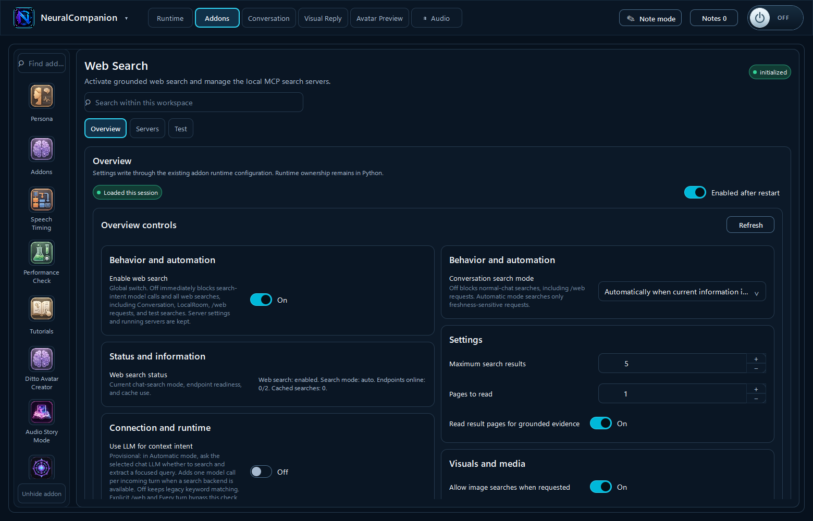

# Web Search

This guide covers NC's dedicated Web Search workflow. For generic MCP servers
and tools assigned to a persona, use [MCP connections and persona tools](mcp.md).
Those connections and approvals do not automatically configure Web Search.

**Web Search** adds current web evidence to the existing main-chat model. It does
not replace the chat provider, and it does not install or start its MCP search
servers silently. Search is performed by local MCP endpoints, and the retrieved
snippets or pages are inserted into the normal chat request.



## Setup Versus Activation

Open **Addons → Web Search** to reach this workspace.

1. **Addon setup:** enable **Web Search** in the Addons workspace and restart NC
   if requested.
2. **Server setup:** in **Servers**, explicitly select **Install / repair search
   servers**, start the installed endpoints, and check them.
3. **Activation:** in **Overview**, enable **Enable web search**, choose a
   **Conversation search mode**, and use the **Web Search** switch in the
   conversation header or Controls.
4. **Verification:** run a diagnostic search in **Test** before relying on a
   chat answer.

Installing a package is not the same as starting a server. Starting a server is
not the same as the conversation switch being on.

## Server Requirements

The default provider chain is:

1. **SearXNG MCP** at `http://127.0.0.1:3000/mcp`
2. **DuckDuckGo MCP** at `http://127.0.0.1:8000/mcp`

Both are expected to use Streamable HTTP mode.

### SearXNG

The SearXNG MCP package is only a bridge. It **requires an operator-provided
SearXNG search instance**. NC does not install or start SearXNG itself. By
default the bridge expects SearXNG at:

```text
http://127.0.0.1:8080
```

Set `SEARXNG_URL` for the NC environment if your instance runs elsewhere. Keep
the SearXNG instance and the MCP endpoints loopback-only unless you have
deliberately secured a wider deployment. A SearXNG MCP endpoint that reports
online still cannot search if the underlying SearXNG instance is unavailable.

### DuckDuckGo

DuckDuckGo MCP is the no-key fallback. It is self-contained after its addon-local
package is installed, but it is still an external service dependency and can be
rate-limited or unavailable. The fallback does not make SearXNG unnecessary when
you specifically want the SearXNG provider.

## Install And Start Servers

Open **Servers**:

1. Review the **SearXNG MCP**, **DuckDuckGo MCP**, and **Server installation**
   status lines.
2. Select **Install / repair search servers**. This explicitly installs the
   DuckDuckGo MCP server into an addon-private Python environment and, when
   Node.js/npm is available, the optional SearXNG MCP bridge into addon-private
   Node storage.
3. Wait for installation to finish. It runs in the background and should not open
   console windows. It does not modify NC's main Python environment.
4. Select **Start local search servers**. This starts the addon-local packages.
5. Select **Check endpoints** to probe both configured loopback endpoints without
   starting anything.
6. If needed, use **Stop NC-managed servers** to stop only processes that this
   addon started.

An endpoint started outside NC is detected and left under external ownership.
NC will not claim or stop it. If you run your own MCP servers, keep their URLs
and lifecycle under your control.

Installation can be cancelled by shutting down the addon. A partial install is
not a working endpoint; re-run **Install / repair** and inspect the per-server
message.

## Test The Chain

Open **Test**:

1. Enter a harmless **Search query**.
2. Select **Run test search**.
3. Read **Diagnostic result**.

The test runs a backend query without sending a chat turn and shows a provider,
title, URL, and snippet, or a concrete error. The test query is sent to the
search backend. If the test fails, do not enable chat search and assume it will
work later; fix the endpoint or fallback first.

## Activate In Chat

Open **Overview**:

- **Enable web search** is the global switch. Turning it off immediately blocks
  search-intent model calls, normal-chat and Local Room searches, explicit
  `/web` requests, and diagnostic test searches. It preserves the saved search
  mode, provider configuration, and running servers.
- **Conversation search mode** selects **Off**, **Automatically when current
  information is needed**, or **Every normal chat turn**.
- **Use LLM for context intent** is an optional, provisional automatic-mode
  check. It asks the selected chat LLM whether to search and extracts a focused
  query, adding one model call per incoming turn when a backend is available.
  Explicit `/web` and **Every normal chat turn** bypass that check.
- **Maximum search results** and **Pages to read** bound retrieval work.
- **Read result pages for grounded evidence** controls whether result pages are
  fetched in addition to snippets.
- **Allow image searches when requested** and **Allow video searches when
  requested** are separate retrieval options.

The **Conversation search mode** and the global switch are separate gates. Both
must allow a search. In particular, mode **Off** blocks explicit `/web` queries;
turning the global switch off also blocks them.

### Conversation switch

In the Chat header, **Web Search** (also available from **Controls** if hidden)
is the activation control for the conversation:

- Turning it on starts installed addon-managed servers and enables chat search.
- If no servers are installed, NC offers setup rather than silently installing.
- Turning it off disables chat search and stops NC-managed search servers.
- Externally managed endpoints keep their own lifecycle.

Do not confuse this with the global **Enable web search** switch. The global
switch blocks search but preserves the saved provider setup and running-server
state; the conversation switch is the per-conversation activation and can stop
NC-managed servers.

## Commands

| Command | Effect |
| --- | --- |
| `/web status` | Show search state |
| `/web auto` | Search when current information is needed |
| `/web always` | Search on every normal chat turn |
| `/web off` | Disable search mode, including explicit `/web` searches |
| `/web clear-cache` | Clear cached web evidence |
| `/web <question>` | Force a one-turn search |

Commands and the UI switches affect the normal chat path. A forced `/web` query
does not override the global off switch or conversation mode **Off**.

## Evidence, Cache, And Privacy

Search results and fetched pages are **untrusted source data**. They can contain
instructions, stale claims, or malicious text. The selected model should use
them as evidence, not as higher-priority instructions. Verify links, dates, and
quotes before relying on an answer.

- **Search result instructions** is guidance prepended to retrieved evidence.
  It does not make the sources trustworthy.
- **Clear search cache** removes stored evidence without changing provider
  settings.
- A search sends the query to the chosen backend. Fetching pages sends requests
  to those sites.
- Search provider keys and MCP endpoint URLs are not stored in presets or
  session data. Do not put credentials in a search query.
- Keep local endpoints loopback-only for a normal desktop setup.

## Troubleshooting

| Symptom | Check |
| --- | --- |
| Search is on but nothing is retrieved | Check the conversation switch, global switch, and mode; run **Test** |
| SearXNG endpoint is offline | Start the SearXNG instance, verify `SEARXNG_URL`, then start/check the MCP bridge |
| SearXNG MCP is installed but cannot search | The bridge is running but the underlying SearXNG instance is not available |
| DuckDuckGo fallback fails | Check endpoint readiness, network access, and rate limiting; the fallback is not guaranteed |
| Install / repair is unavailable | Wait for any current installation to finish; re-read the installation message |
| External server was not started or stopped | NC only manages processes it started itself |
| `/web` is rejected | The global switch or conversation mode may be off |
| Answers cite poor sources | Adjust result and page limits, use a better SearXNG instance, or verify the links yourself |

## Current Limits

- SearXNG MCP requires a separately running SearXNG instance. NC does not
  install, configure, or launch SearXNG.
- The DuckDuckGo fallback is convenient but not a substitute for a reliable
  private search backend.
- Search introduces latency and can add a model call in automatic mode.
- Automatic mode uses freshness heuristics unless **Use LLM for context intent**
  is enabled; neither is a guarantee that every needed fact is found.
- Fetched pages and snippets are untrusted and may be incomplete.
- Search does not make the LLM's answer authoritative; verify important claims.
- Image and video search permissions do not guarantee a usable result.

## Related Guides

- [Main Chat Remote](main_chat_remote.md)
- [Local Room](local_room.md)
- [Addon setup and index](../manual/addons.md)
