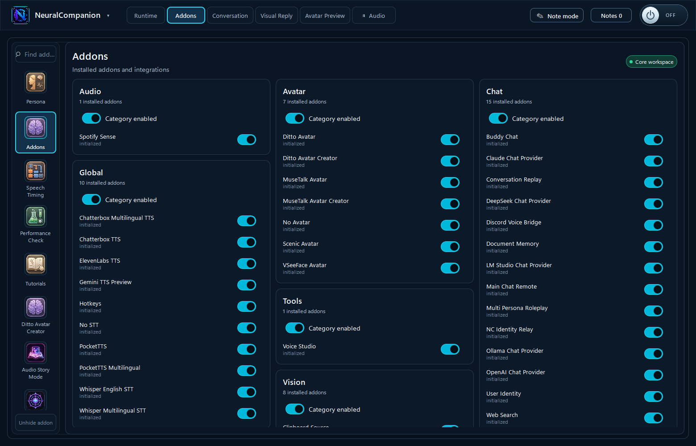

# Addons

Most Neural Companion features beyond the basic chat and speech runtime are
provided by addons. Use the **Addons** workspace to enable an addon, open its
settings, and see whether it is loaded in the current session.



## Hidden Addon Icons

Hiding an icon only changes the Addons rail; it does not disable the addon.
Use **Unhide addon** at the bottom of the rail to restore a hidden icon.
Disabled or unloaded addons remain in that pop-up, grayed out and labeled
**Disabled** or **Not loaded**. They cannot be unhidden until enabled and loaded.
Enable them in Addons and restart when required. Their hidden preference is kept,
including when you hide, unhide or reorder other icons.

Neural Companion remembers the selected Addons page and its inner tab between
restarts. If that addon is hidden, disabled, removed or not loaded at startup,
the first available tab at the top of the rail is selected instead. Runtime also
remembers its selected section. These UI choices are grouped under `navigation`
in `runtime/qml_workspace_layout.json`.

## Setup Is Not Activation

An addon can load successfully and still do nothing until you configure and
start it. Keep these two stages separate:

1. **Setup:** enable the addon, restart Neural Companion when the toggle says
   **Enabled after restart**, then install or point it at anything it needs.
2. **Activation:** use the addon's own **Enable**, **Connect**, **Start**, or
   **Switch** control for the current session. For example, Web Search still
   needs installed MCP servers, Main Chat Remote still needs a connected phone,
   and Voice Studio still needs its generated WAV assigned to a Persona.

The status chip on an addon page describes ownership or load state. In
particular, **Initialized**, **Loaded this session**, and **Core workspace** do
not prove that an external service is online, an account is verified, or a
feature is active in the current conversation.

### Addon Manager controls

- **Enabled after restart** applies the addon selection on the next launch.
- **Loaded this session** means the addon code is available now.
- **MCP Core** is required Runtime infrastructure and has no optional loading
  switch. Use **Runtime → MCP Core → Allow MCP access** to control its access.
  See [MCP connections and persona tools](../addons/mcp.md).
- Disabling an addon can remove its panels and provider choices after restart.
  Review active provider selections before disabling a provider addon. The
  manager toggle does not uninstall external runtimes or delete generated assets.
- Some addons expose a top-level tab; others live inside another addon's
  workspace. **Local Room**, for example, is a section of the **Discord Voice
  Bridge** addon (shown as the **Discord Voice** tab) even though it does not
  require Discord.

## User Guides

### Chat, voice, and connections

| Guide | Use it for | Scope |
| --- | --- | --- |
| [Buddy Chat](../addons/buddy_chat.md) | Several buddy personas participating naturally in the normal main chat | Uses the main conversation |
| [Local Room](../addons/local_room.md) | A moderated local persona discussion | Uses a separate room and participant memories |
| [Discord Voice Bridge](../addons/discord_voice.md) | Persona bots speaking in a Discord voice channel | Requires Discord bot credentials and a configured server/channel |
| [Main Chat Remote](../addons/main_chat_remote.md) | Using the desktop Main Chat from a native phone app over LAN or the internet | Uses the desktop runtime and conversation |
| [Main Chat Remote: Secure Internet Setup](../addons/main_chat_remote_internet_setup.md) | NC Relay accounts, encrypted peer connections, and internet troubleshooting | Uses the relay pairing workflow |
| [Web Search](../addons/web_search.md) | Retrieving web evidence through installed MCP search servers | Requires a configured server and search tool |
| [MCP connections and persona tools](../addons/mcp.md) | Shared external tools, persona grants, and the standalone transcript example | A saved connection, addon grants and persona assignments are separate |
| [Companion Chess](../addons/companion_chess.md) | Local persona games, optional Launchpad and online human matches | Desktop play needs no MIDI hardware |
| [User Identity](../addons/user_identity.md) | Describing the human user and optionally reusing the user's portrait in Visual Replies | Stores the human profile separately from companion personas |

### Voices and identity

| Guide | Use it for | Important limit |
| --- | --- | --- |
| [Voice Studio](../addons/voice_studio.md) | Creating and organizing reusable character WAV references | Saving a WAV does not assign it to a Persona or change the main chat voice |
| [NC Identity Relay](../addons/identity_relay.md) | Importing an external assistant identity artifact, reviewing it, and enabling continuity per Persona and conversation | Importing or selecting an artifact does not activate it |

### Stories and group experiences

| Guide | Use it for | Scope |
| --- | --- | --- |
| [Multi Persona Roleplay](../addons/roleplay.md) | A cast, narrator, AlternativeReality, authored scenes, and an isolated **Play** feed | Uses its own story session |
| [Audio Story Mode](../addons/audio_story_mode.md) | Turning imported audio, Markdown, or chatlogs into a planned, illustrated playback project | Uses imported material and a playback timeline |

The four group experiences solve different problems:

- **Buddy Chat** changes who speaks inside the normal Main Chat.
- **Local Room** creates a separate local room with turn-taking, a moderator,
  and per-participant room memory. It can use voice or **Text Only** input but
  never runs at the same time as Main Chat.
- **Multi Persona Roleplay** runs an isolated story feed with a cast and its own
  **Start Play** and story memory.
- **Audio Story Mode** is a production and playback workflow. It follows an
  imported source and a timeline; it is not a live conversation.

## Addon Data And Privacy

Addon settings and generated assets usually live under:

```text
runtime/addons/
```

The exact folder depends on the addon. Voice references, story packages,
generated images, and logs are local user data. They are not part of the main
source repository. Treat imported identity artifacts, web evidence, and
provider responses as untrusted content, and review what leaves your machine
before enabling a cloud provider or an owner override.

## Developer Documentation

Addon development documentation remains in the main `docs/` folder:

- [Addon Quickstart](../addon_quickstart.md)
- [Addon Templates](../templates/README.md)
- [Execution and ownership](../addon_capability_contracts.md#execution-and-ownership)
- [Addon Capability Contracts](../addon_capability_contracts.md)
- [Addon State And Presets](../addon_state_and_presets.md)
- [Chat Provider Addons](../chat_provider_addons.md)
- [Vision Source Addons](../vision_source_addons.md)
- [Vision Supervisor Addons](../vision_supervisor_addons.md)
- [Visual Reply Addons](../visual_reply_addons.md)
