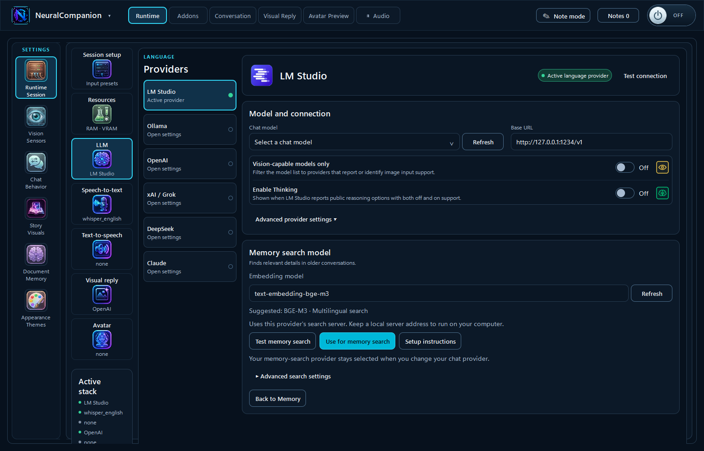

# Chat and speech

NeuralCompanion separates the model that writes replies, the provider that transcribes your microphone, and the provider that speaks the reply. You can use text chat alone, spoken replies with typed input, or a full voice conversation.

Complete [First run](first-run.md) before adding speech. Provider choices depend on the addons installed and loaded in your copy.

## Setup is not activation

Each role has its own page and its own activation control. Selecting a provider card only opens its settings.

| Role | Where to configure it | What activates it |
| --- | --- | --- |
| Language model | **Runtime → Runtime Session → LLM** | **Make active** |
| Speech input | **Runtime → Runtime Session → Speech-to-text** | **Use for speech input** |
| Speech output | **Runtime → Runtime Session → Text-to-speech** | **Use for voice output** |
| Visual reply | **Runtime → Runtime Session → Visual reply** | **Make active** |
| Avatar | **Runtime → Runtime Session → Avatar** | **Use this avatar** |

The active route is shown by the **Active language provider** badge or the **Active provider** marker on its card. Opening the same page later does not change what the runtime uses.

## Connect a chat model

Open **Runtime → Runtime Session → LLM**. Available providers include **LM Studio** (the default, using the Python SDK), **Ollama**, **OpenAI**, **xAI / Grok**, **DeepSeek**, and **Claude**. The optional **LM Studio (REST)** provider is disabled by default; enable its add-on and restart NC to show it.

1. Select a provider to view **Model and connection**.
2. For **LM Studio**, run its local server with a downloaded model. NC's normal companion installation includes the pinned `lmstudio` Python SDK; see [LM Studio](../addons/lmstudio_sdk.md). For **Ollama**, run its local server. Check the base URL, choose **Refresh**, and select the chat model. A downloaded model alone does not mean its server is reachable.
3. For a hosted provider, enter its API credentials and model. A subscription to a separate chat app does not configure API access in NC.
4. Choose **Test connection** and read the result. This checks the provider's model catalog; send a short message after initialization to verify actual generation. For Ollama, this check also asks Ollama to unload its running models.
5. Choose **Make active** and verify the **Active language provider** badge.

**LM Studio** keeps the existing SDK provider ID (`lmstudio_sdk`). **LM Studio (REST)** keeps the original ID (`lmstudio`). Their settings and model selections remain separate; switching does not copy values. Saved add-on choices are preserved, so an existing installation can still show REST until you disable it and restart.

### Provider behavior

| Provider | Connection | Thinking and reasoning | Sampling and limits |
| --- | --- | --- | --- |
| **LM Studio** | Default SDK provider, normally `http://127.0.0.1:1234`. Use a plain `http` host and port; URL credentials and custom paths are rejected. | **Enable Thinking** appears only for a model verified to support both `off` and `on`. The choice is frozen for the turn and verified against the server. | Temperature, Top P, Top K, Repetition Penalty, Min P, and Max Tokens (`-1` = no explicit cap). Context Length is `0` for the loaded model or NC profile default, otherwise 512–1,048,576. |
| **LM Studio (REST)** | Optional, disabled by default; requires LM Studio 0.4.7+ and its Responses API. | **Enable Thinking** appears only when the model catalog reports both `off` and `on`. | Temperature, Top P, and Max Tokens. Top K, Repetition Penalty, and Min P must be set in LM Studio. Context Length is 512–1,048,576 tokens; the default is 8,192. Settings are independent from the default provider. |
| **Ollama** | Local OpenAI-compatible endpoint, normally `http://127.0.0.1:11434/v1`. The default API key is a dummy value, not an account credential. | **Enable Thinking** appears only when Ollama reports the model's `thinking` capability. On sends `reasoning_effort=medium`; off sends `none`. | Temperature, Top P, and Max Tokens. Top K, Repetition Penalty, and Min P cannot be overridden over this connection; set them in the Ollama model (Modelfile). Starting or stopping the NC runtime, or testing the connection, may unload running Ollama models. |
| **OpenAI** | Hosted. The official API URL uses the Responses API; a custom Base URL uses Chat Completions. | No thinking switch is exposed. | Temperature, Top P, and Max Tokens. On the official Responses path, a model that rejects Temperature or Top P as unsupported is retried without that field, and `gpt-5.6` models use the provider defaults for both. |
| **xAI / Grok** | Hosted; default Base URL `https://api.x.ai/v1`. | No thinking switch is exposed. | Temperature, Top P, and Max Tokens; `-1` omits the output cap. |
| **DeepSeek** | Hosted; default Base URL `https://api.deepseek.com`. | **Thinking** offers Enabled or Disabled. **Reasoning Effort** offers Default, High, or Max. | Temperature, Top P, Frequency Penalty, Presence Penalty, and Max Tokens up to 393,216. Image input is not supported. |
| **Claude** | Hosted Messages API; API Version defaults to `2023-06-01`. | No thinking switch is exposed. | Max Tokens is required: 1–8,192, default 1,024. Temperature is exposed without Top P; Top K is optional (`0` = off). If Claude rejects Temperature or Top K as deprecated, NC retries without that field. |

When a provider supports the shared **Enable Thinking** switch, it appears under **Model and connection**, before **Advanced provider settings**. DeepSeek's **Thinking** choice is inside Advanced because it is a provider-specific mode. A provider without a thinking control may still reason internally; this build simply does not expose a switch for it.

**Context Length** is a model-load setting, not the number of recent chat messages. Both LM Studio transports show it. Changing it may reload the selected model on its next use. In the default SDK-backed provider, `0` reuses the loaded model's current context or NC's profile default, and changing a nonzero value reloads that named instance while leaving other loaded model instances alone.

**Advanced provider settings** contains optional generation and model-load controls. Keep the defaults until you have a specific reason to change them. Sampling values are saved per provider, so changing LM Studio does not change Ollama or a hosted provider.

The model's context window must hold both input and generated output. Input
includes instructions, conversation, tool definitions and tool results; reasoning
can also consume capacity. **Max Tokens** is a separate output cap and cannot
create room beyond the context window. A large transcript can therefore leave
little room for the answer even when the output cap is unlimited. NC's recent
message/history controls do not enlarge a model's context.

A saved persona can override the language provider and model for its own requests. Check **Persona → Overrides** when chat uses something other than the default you expected. An unavailable persona override reports an error when used; it does not silently fall back to another model.

Choose an image-capable model for attached photographs or screenshots. The **Vision-capable models only** filter uses reported image support, with a conservative model-name fallback when the catalog omits it. Test the actual model with a simple image. The filter is not enabled automatically.

**Tool-capable models only** is available for both LM Studio transports and Ollama when their catalogs supply tool capability data. It uses reported support, not guesses about a model's intelligence or reliability. Models with unknown support remain visible; the control is unavailable on providers that cannot supply this information. See [MCP connections and persona tools](../addons/mcp.md) for permissions and the distinction between support and reliable tool use.

The **Memory search model** card configures conversation recall independently of normal chat. You can keep Claude or DeepSeek active for replies while using a local LM Studio or Ollama embedding model for search. OpenAI embeddings send text to that API and use your API account. See [Memory](memory.md).

## Use Conversation

Open the [Main chat and conversation guide](conversation.md) for sending and queued replies, message actions, history edits and deletion, saving and loading, reading and appearance controls, images, slash-command drafts, personas, and web search.

The guide distinguishes display controls from provider, speech, and memory settings. Continue below to configure spoken replies or microphone input.

## Add spoken replies

Open **Runtime → Runtime Session → Text-to-speech**. Available providers include **Chatterbox**, **Chatterbox Multilingual**, **PocketTTS**, **PocketTTS Multilingual**, **LiquidAI**, **ElevenLabs TTS**, and **Gemini TTS Preview**. Local providers need their models; PocketTTS also needs its isolated runtime. Hosted providers need their own API access. **None** keeps text replies but produces no speech.

1. Select the provider card and review its settings and readiness status.
2. Configure its required voice, language, model, or credentials. Use its available readiness checks. Each speech provider keeps its own voice and generation settings.
3. Choose **Use for voice output** and confirm the **Active provider** marker.
4. Use the header **Audio** menu to choose the output device and check levels.
5. Stop and initialize the configured runtime when the provider requires a reload, then send a short message from Conversation.

### TTS provider behavior

| Provider | Runs | Controls to expect |
| --- | --- | --- |
| **Chatterbox** | Local, separate worker process; non-streaming synthesis. | Use cloned voice / persona reference, Seed (`0` = randomized), Temperature, Top P, Top K, Repetition Penalty, Normalize loudness, Apply audio watermark, Prewarm. |
| **Chatterbox Multilingual** | Local, main NC process; non-streaming synthesis; 23 languages. | Language, its own Seed (`0` = randomized), Temperature, Top P, Exaggeration, CFG weight, Min P, Repetition Penalty, Use cloned voice / persona reference, Apply audio watermark, Prewarm. |
| **PocketTTS** | Local isolated interpreter; streaming synthesis. | Built-in voice or cloned reference, Temperature, LSD decode steps, End-of-speech threshold, Frames after end-of-speech, Prewarm. |
| **PocketTTS Multilingual** | Same isolated interpreter; streaming synthesis; English, French, German, Spanish, Portuguese, or Italian. | Language and voice controls plus the same PocketTTS generation controls. |
| **[LiquidAI](liquidai-tts.md)** | Local, dedicated environment and separate worker; completed speech chunks. | Speech language, Female/Male voice, independent Seed, Audio temperature, Audio top-k, Audio repetition penalty, Generation budget, Prewarm, Install / Repair. |
| **ElevenLabs TTS** | ElevenLabs cloud; non-streaming synthesis. | API key, Base URL, Voice, Model, optional language code, Stability, Similarity, Style exaggeration, Speed, Speaker boost. Audio is requested as 24 kHz PCM. |
| **Gemini TTS Preview** | Gemini preview cloud endpoint; non-streaming synthesis. | API key, Base URL, Model, Voice, optional language code, Style prompt. Preview model IDs can change outside NC. |

**Independent seeds and settings:** Chatterbox and Chatterbox Multilingual store separate seeds and sampling values. Changing the standard Chatterbox seed does not change the multilingual seed, or the reverse, and switching the active provider does not copy values between them. Seed `0` leaves generation randomized; a positive seed requests a fixed starting point, but identical audio is not guaranteed. PocketTTS, ElevenLabs, and Gemini do not expose a seed in this build.

**Chatterbox variants:** NC's **Chatterbox** provider runs the English **Turbo**
implementation, not the original English model. Turbo ignores Min P, CFG weight
and exaggeration, so those controls are absent. Multilingual is a separate
implementation; its Min P, CFG weight and exaggeration controls remain available.
See the provider-specific [Turbo](../../addons/chatterbox_tts/README.md) and
[Multilingual](../../addons/chatterbox_multilingual_tts/README.md) supported-control lists.

Both Chatterbox providers use separate worker processes. Multilingual's CUDA
worker uses passive CPU waiting to reduce unnecessary CPU consumption; this
does not change its sampling settings or other providers. NC retains audio
playback, and Stop/unload closes the worker. No special launcher is needed.

Turbo preserves `0` for Top K (disable the filter) and Top P (retain the most
likely token). Its configured sampling values also apply to voice auditions;
explicit captured reply parameters take precedence over current settings.
Normalize loudness processes a reference recording, not desktop playback volume.
Old saved Turbo Min P values stay readable but are not used. Existing defaults
and separate provider seeds/settings are retained.

The expected result is a text reply with audible speech through the chosen output. If text works but sound does not, check the active speech-output provider, output device, playback state, and provider error before changing the language model.

**Chatterbox (Turbo)** runs in a separate worker process using NC's existing Python environment, model files and CUDA libraries. It starts when warmup or speech needs it and stays available for the active session. **Stop** closes the worker to release its model, native caches and private memory; **Runtime → Resources → Unload** can also close it when idle. The next initialization repeats worker startup and warmup. Speech chunks, voice settings, playback and avatar rendering use the same flow as before. No additional environment is required. This process lifecycle applies to Chatterbox; Chatterbox Multilingual keeps its existing runtime. Both Chatterbox providers perform non-streaming synthesis, so NC splits long replies into speech chunks instead of streaming model audio.

For reference-based voices, open **Addons → Persona → Voice**. **Play original sample** plays the recording; **Generate test** tries your own text when Chatterbox or Chatterbox Multilingual is loaded. Previewing does not assign the voice. After changing the selection, choose **Use this voice for …** to save it to the selected persona. See [Personas](personas.md) for voice assignment.

**Addons → Voice Studio** organizes the shared voice library and can create new references with a configured cloud or local service. Saving a WAV in Voice Studio does not automatically replace the chat voice; see the [Voice Studio guide](../addons/voice_studio.md) for the library and assignment workflow.

Additional reference recordings belong in `voices/`. Some approved samples ship with NC; use other recordings only with appropriate permission. Compatibility and reference requirements vary by speech provider. For PocketTTS cloning access, see [PocketTTS](pockettts.md).

## Add microphone input

1. In **Session setup**, choose **Voice Activation**, **Push-to-Talk**, or **Always On** instead of **Text Only**.
2. In **Speech-to-text**, select the appropriate provider and choose **Use for speech input**. Available options include **Whisper English**, **Whisper Multilingual**, and **None** (or **Disabled** when the No STT addon is unavailable).
3. Select the input device in the header **Audio** menu and check the live input levels.
4. For Push-to-Talk, review the binding in **Addons → Hotkeys**. The default is **Right Ctrl**. Hold it while speaking a short sentence.
5. Confirm the recognized text and response before trying longer speech.

Input mode and speech-to-text are separate from speech output. Changing the speaking voice does not change microphone transcription. Return to **Text Only** for a session without microphone input, or activate the speech-to-text off choice to disable transcription explicitly.

## Adjust timing after audio works

Open **Addons → Speech Timing** to tune completed-response and streaming chunk sizes. Streaming can begin speaking before the whole reply arrives. Smaller chunks may reduce the delay to first speech; larger chunks may sound more continuous. Sentence boundaries and minimum sizes help avoid unstable fragments.

**Avatar non-stream** applies to both Ditto and MuseTalk when streaming is off. Its first two quickstart controls set the first and second speech chunks; the regular target and maximum apply after those. **Standard** applies to non-stream speech with other avatar modes or no avatar. **Avatar streaming** is shared by all streaming speech, including speech without an avatar. Existing saved timing values are retained.

Speech Timing controls text context and when text reaches speech synthesis. It does not require a streaming-capable provider to finish all audio before playback. [LiquidAI's optional progressive local playback](liquidai-tts.md#earlier-local-playback) can begin within a text chunk; avatar and remote routes retain their existing audio delivery.

### Save and load a timing setup

Use **Saved speech timing setups** on the Speech Timing page to keep named combinations, such as “Ditto + Chatterbox”. Enter a name and choose **Save current**; no Performance Check is required. This saves all three groups of timing values and records the selected avatar engine, TTS provider, language provider/model and streaming mode. Saving an existing name asks before replacing its profile.

Choose a saved setup to see its recorded selections, then press **Load**. The **Also load providers and model** switch beside Load is off by default. With it off, only timing values change. With it on, Load also restores the recorded provider/model selections and streaming mode. Stop the chat before restoring different providers or a different model. The Load button saves the selection for NC's normal initialization flow; it does not start or download models.

Profiles do not contain credentials, server endpoints, voices or avatar packages. Providers must already be configured. Older profiles without a recorded language-provider identity can still load their timing values; their language model is left unchanged. An unavailable provider produces an error when restoring the full setup; you can still load timing only.

**Delete** permanently removes the selected profile after confirmation. Timing setups share the existing performance-profile folder, so the same file can appear in Performance Check. Its existing loader applies only timing values from newly saved speech timing setups; optional provider/model restoration is controlled on the Speech Timing page.

Change one control at a time and compare the same short prompt. Use [Performance Check](performance.md) when you need measurements across the selected language, speech, and avatar stack rather than a single listening comparison.

For missing replies, silent playback, authentication problems, or device issues, see [Troubleshooting](troubleshooting.md).
