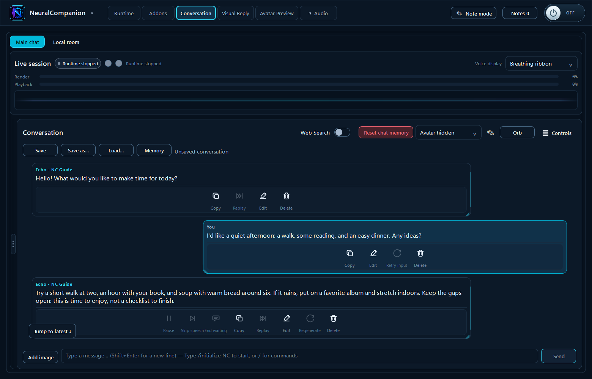
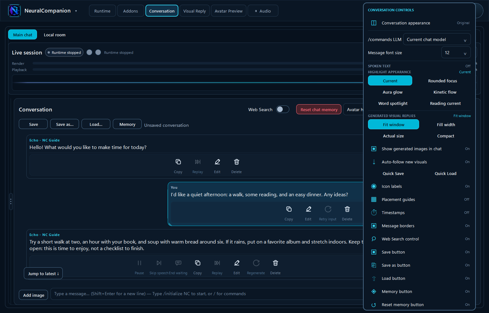
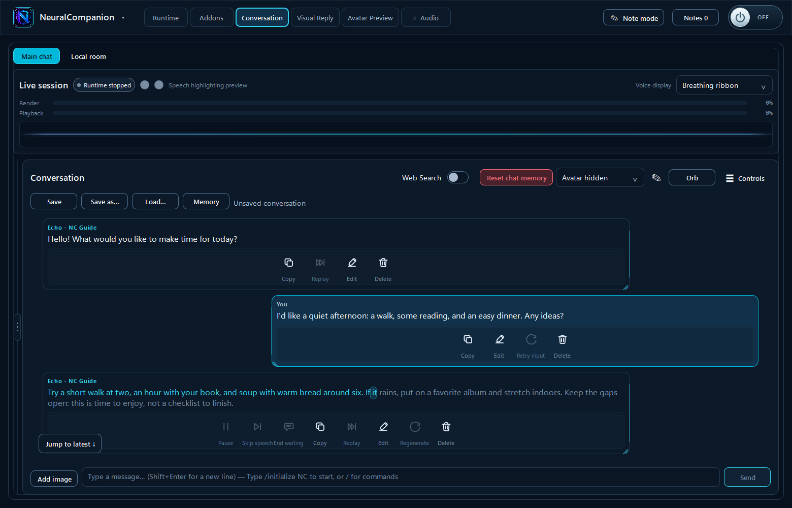
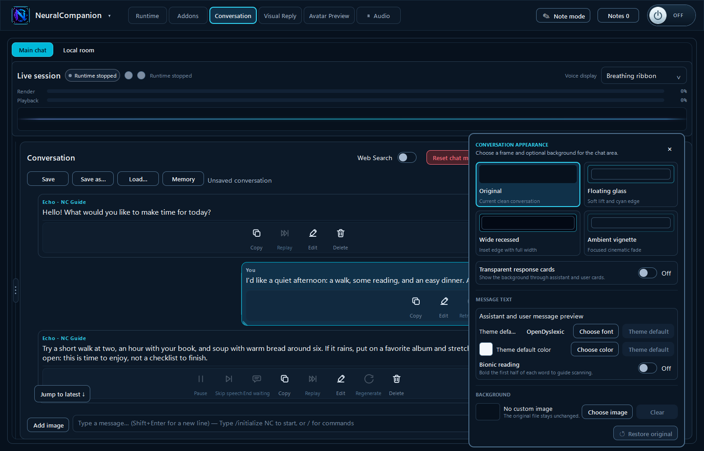
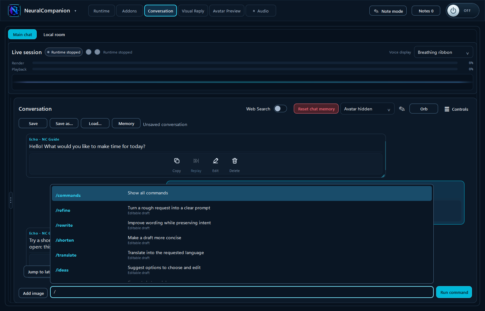

# Main chat and conversation controls

Use **Conversation → Main chat** for typed messages, spoken replies, images, and the current chat history. Complete [First run](first-run.md) to initialize NC; [Chat and speech](chat-and-tts.md) covers language providers, microphone input, and voice output.

This native-UI capture uses illustrative messages in an isolated example session.
The runtime is stopped, so actions that need an active model or speech provider
are unavailable. Initialize NC before sending a new message.

When a room is available, the selector above Conversation also offers **Local room** or **Discord room**. Selecting a view does not start or stop that room. An active room blocks normal main-chat input and runtime actions: use its own composer or stop it first. See [Local Room](../addons/local_room.md) and [Discord Voice Bridge](../addons/discord_voice.md).

## Send a message

1. Check **Live session** for **Runtime active**. If stopped, initialize through the app header or type `/initialize NC`.
2. Type in the composer. **Enter** submits; **Shift+Enter** inserts a new line. A long draft scrolls within the composer.
3. Choose **Send**. A message beginning with `/` changes the button to **Run command**.

A new message can queue while NC is generating or speaking. **Skip speech** draws attention when speech is holding up a queued reply. A turn submitted during an inline message edit waits until editing finishes. Read the status or notification before submitting the same message again.

The ready indicator means NC is waiting for voice or text input; the microphone indicator shows when input is recording. The **Render** and **Playback** bars distinguish speech preparation from audio already played. **Phone-ready** and **Download-ready** appear when relevant to the active delivery route. **Voice display** selects **Breathing ribbon**, **Spectrum cells**, or **Kinetic current**; it changes the activity visualization.

## Use message actions

Actions appear below user and assistant cards. Hover over an icon for its meaning; enable **Controls → Icon labels** to show names below the icons. Actions depend on the message, runtime state, and any edit in progress.

| Action | What it does |
| --- | --- |
| **Pause** / **Play** | Pause or resume the active response. |
| **Skip speech** | Skip the current spoken response, including when a queued reply is waiting. |
| **End waiting** on the latest assistant response | Continue without waiting for another user reply. |
| **End waiting** on an eligible user message | Ask NC to reply to that waiting user message. |
| **Copy** | Copy that message's text. |
| **Replay** on an assistant response | Speak the saved response again through TTS. It does not request a new answer. **Stop replay** appears above the transcript while replay is active. |
| **Regenerate** on the latest assistant response | Request another answer through the runtime. |
| **Retry input** on the latest user message | Retry the latest user input through the runtime. |
| **Edit** | Open an inline draft of that message. |
| **Delete** | Confirm removal of that message and its attachments and reconcile associated memories. |

**Regenerate** removes the latest assistant reply and generates again from the
remaining conversation; it does not add another user message. Earlier messages,
including an earlier assistant message, remain in context. The replacement can
use the persona's currently allowed MCP tools and can perform another external
action. Use **Replay** when you only want to hear the saved reply again. See
[MCP connections and persona tools](../addons/mcp.md) before regenerating a turn
that changed something outside NC.

To change icon order, drag actions along the rail on the latest assistant or user card. User and assistant layouts are separate. **Controls → Placement guides** identifies the action rail; **Icon labels** controls its captions. These preferences do not enable or disable the underlying actions.

## Edit or delete history

Choose **Edit** on a user or assistant message, change its text, then use the inline **Save** or **Cancel**. Saving changes the existing conversation message; replay uses the saved edited response. It does not automatically rewrite later replies. Finish or cancel the draft before using actions that are disabled during editing.

For several changes, choose the pencil **Edit conversation** button above the transcript, then **Start edit mode**. Edit the displayed message text, select messages for **Delete selected**, or Shift-click to select a range. **Clear selection** changes the selection only. Reopen the pencil menu and choose **Apply changes** or **Cancel editing**. Apply commits the edited history; use the main **Save** afterward to update a named chat file.

Single-message **Delete** requires the current reply, playback, and other chat edits to finish. Its confirmation removes the selected message, attached assets that are no longer shared, and memories attributable to that message. Memories whose source cannot be identified and images still used elsewhere are preserved. Later replies remain, including any text they repeated from the deleted message. Save afterward if you want the deletion reflected in the saved conversation. See [Memory](memory.md) for inspecting and managing retained information.

## Save, reopen, or start again

| Control | Use it for |
| --- | --- |
| **Save** | Save the current conversation, choosing a name when needed. |
| **Save as…** | Save to another named chat file. |
| **Load…** | Open a saved chat context. |
| **Controls → Quick Save** | Save the complete current chat context to the separate quick-save file. |
| **Controls → Quick Load** | Restore that quick-save context. |
| **Reset chat memory** | Confirm a new in-memory conversation through the session reset path. |
| **Controls → Clear visible transcript** | Clear the displayed transcript while keeping canonical chat memory. This does not erase the conversation. |

The current name, or **Unsaved conversation**, appears above the messages. When an operation would replace unsaved context, **Unsaved chat context** offers **Save**, **Don't Save**, and **Cancel**. A summary or archived chunks do not replace a saved chat.

If file or memory buttons are missing, open **Controls** and turn on **Save button**, **Save as button**, **Load button**, **Memory button**, or **Reset memory button**. These are toolbar visibility switches. Hiding **Memory** does not disable memory or delete anything.

Conversation memory requires a saved chat name and its own opt-in settings. Open **Memory** to choose summary, older-message storage, and recall behavior. Saving a transcript does not by itself turn on learning or retrieval; see the [Memory guide](memory.md).

## Read comfortably and follow replies

Open **Controls** and scroll through the menu for:

- **Message font size**, **Timestamps**, and **Message borders**.
- **Word spotlight**, which highlights the word being spoken, or **Reading current**, which shows a moving reading highlight. Click the selected mode again to turn highlighting off.
- Highlight appearance: **Current**, **Rounded focus**, **Aura glow**, or **Kinetic flow**. Appearance and highlight mode are separate choices; a style alone does not turn highlighting on.
- **Autoscroll** to follow the conversation and **Split console and conversation** to show system output beside it.

Speech highlights follow the active spoken response when playback information is available. They do not change the spoken text or the voice provider. The split console has its own **Autoscroll**, **Clear**, and **Split** controls; its scrolling preference is separate from transcript autoscroll.

The image above is a display-only highlight preview using the native renderer;
no audio was generated for this documentation example.

Scroll upward to read history. Older messages load in batches; **Load older messages** is available at the top when more remain. **Jump to latest ↓** returns to the newest messages. New visuals can signal their arrival through this button without pulling you away from earlier messages. **Auto-follow new visuals** works with conversation autoscroll.

Drag the right edge of an assistant card or the left edge of a user card to change widths for that type of message. Drag its lower corner to change width and minimum height together. Double-click a handle to reset that type's sizing; user width returns to automatic. Longer text can still make a card taller than its minimum.

### Room reading preferences

The room conversation has **Text and speech** and **Appearance** buttons. **Text and speech** includes font size, timestamps, message borders, spoken-text mode, highlight appearance, and response/user card-size sliders. These use the same persisted reading and appearance preferences as Main chat, so changing them can affect both displays. Room playback, participants, sending, and session controls follow the room's own rules; main-chat message actions do not become room controls.

## Change the chat's appearance

Choose **Controls → Conversation appearance**:

- Pick **Original**, **Floating glass**, **Wide recessed**, or **Ambient vignette** for the chat-area frame.
- Turn on **Transparent response cards** to show the background through both assistant and user cards.
- Under **Message text**, choose **OpenDyslexic** or **Choose font**, select a text color with **Choose color**, and use each **Theme default** button to clear that override.
- Enable **Bionic reading** to bold the first half of each word for scanning.
- Under **Background**, use **Choose image** or **Clear**. The original image file stays unchanged.

**Restore original** resets the frame, custom background, transparency, message font/color overrides, and bionic reading. Font size and spoken-text highlighting have separate controls. For app-wide themes and layout, see [Interface appearance](../custom-appearance.md).

## Attach or work with images

Use **Add image**, drop image files onto Conversation, or paste a clipboard image into the composer. Review the staged thumbnails and remove individual images with their × buttons. Add an optional question or comment, then send. The active chat model must support images; a text-only model cannot interpret an attachment just because it appears in the chat.

Generated Visual Replies appear with assistant responses. Right-click a generated image for **Open and zoom**, **Comment on this image**, **Add variation**, **Save image as…**, **Copy image**, or **Open file location**, when available. Focus view offers zoom and panning. Commenting stages the image for your next message; variation uses its generation context.

**Controls** offers **Fit window** (show the whole image), **Fill width** (may crop), **Actual size** (pan at generated pixel dimensions), and **Compact** (shorter preview). **Show generated images in chat** changes their display; **Auto-follow new visuals** controls following them. See [Visual Reply and sensory features](visual-reply-and-sensory.md), the [image toolbar guide](../visual_reply_toolbar.md), and [Visual Reply commands](visual-reply-commands.md) for generation setup and image tools.

## Use slash commands and reviewed drafts

Type `/` or `/commands` for the current command catalog. Use Up/Down and Enter to select a suggestion, or Escape to close suggestions. Availability and reasons appear in the list; addon controls require the corresponding loaded addon.

Writing commands `/refine`, `/rewrite`, `/shorten`, `/translate`, and `/ideas` prepare an editable draft. Include your source text and any target language or constraints after the command. Review the draft, edit it or select an idea, then choose **Send draft**. **Copy**, **Regenerate**, **Restore original**, **Discard**, and **Cancel** during generation let you manage the draft before submitting it as a chat turn.

**Controls → /commands LLM** chooses the provider used to prepare command drafts. `/current`, `/openai`, `/xai`, `/deepseek`, and `/claude` select that command provider; they do not change the normal chat provider. Check the model and availability shown for the choice.

Other shortcuts include `/initialize NC`, `/stop NC`, `/persona`, `/voice`, display toggles, and available addon switches such as `/websearch`, `/orb`, `/presence`, `/spotify`, `/buddy`, and `/roleplay`. Switch commands accept `on` or `off`; without an argument they toggle. `/audiostory play`, `pause`, and `stop` control the current story. Use [Visual Reply commands](visual-reply-commands.md) for `/generate_visual` and `/generate_visual_refine`, and [Desktop restart](desktop-restart.md) for `/restart_nc` and its confirmation/cancellation flow.

## Personas, web evidence, and related tools

The **Persona avatar display** selector offers **Avatar hidden**, **Single portrait**, **Mood portraits**, and **Portrait + mood ring**. Right-click a portrait for **Avatar options**: resize it, choose a saved quick persona, or change only the conversation voice. Persona changes restore that persona's saved voice. Manage quick personas, instructions, portraits, and provider/context overrides in [Personas](personas.md). A portrait in a message and a live animated avatar use different settings; see [Avatars](avatars.md).

**Web Search** above the transcript enables the configured web-search route. If its servers are missing, NC offers **Open Web Search addon**. **Controls → Web Search control** only shows or hides this switch. See [Web Search](../addons/web_search.md) for servers, evidence, and policies.

When available, **Identity Relay** enables or suspends imported continuity for this conversation, **Spotify** opens the quick player, and **Orb** opens its overview. Their setup and permissions remain in [NC Identity Relay](../addons/identity_relay.md), [Spotify Sense](../addons/spotify_sense.md), and [Companion Orb](../addons/ai_presence_companion_orb.md). [Buddy Chat](../addons/buddy_chat.md), [Roleplay](../addons/roleplay.md), and [Main Chat Remote](../addons/main_chat_remote.md) have their own guides.

## Adjust context and writing behavior

Open **Runtime → Chat behavior → Conversation** for **Context messages**, **Overflow policy**, **Stored history limit**, and display batching. **Chat messages per visual batch** affects nearby rendered messages; it does not change saved history or the language model's context. **Context messages** controls recent messages included in a normal provider request. A persona can override context size.

The **Writing** tab contains composer spellcheck and response-length settings; **Proactive** controls unsolicited replies; **Memory** opens conversation memory. Use the navigation rail to reach these settings without treating chat display preferences as model settings. For missing replies, stale context, unavailable actions, or failed playback, see [Troubleshooting](troubleshooting.md).
