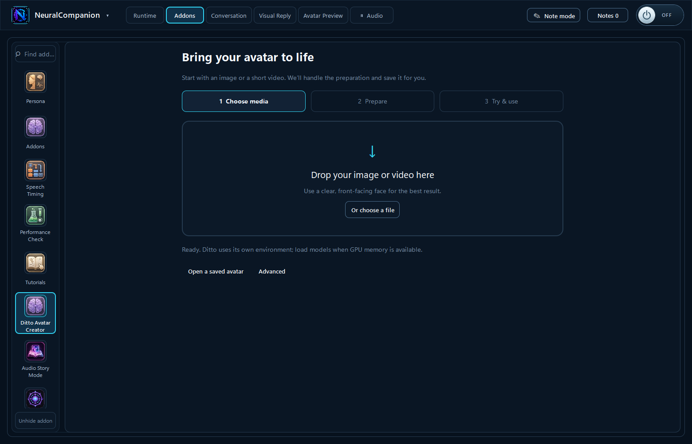

# Ditto avatars

Ditto animates a portrait or short video into a local talking avatar. It has its
own installation, model files, and preparation workflow. A MuseTalk pack cannot
be used as a Ditto package, and preparing a Ditto avatar does not activate it.

## Before you start

Use a clear, front-facing face you have permission to use. The current installer
targets Python 3.11 and NVIDIA CUDA, and the runtime needs its own environment;
do not assume the main application environment can run Ditto.

Install the isolated component with the graphical installer, or from the
installation root:

```powershell
py -3.11 install_neural_companion.py --ditto --non-interactive
```

The installer creates `Ditto/.venv/` and checks the required models. In
**Runtime → Runtime Session → Avatar → Ditto**, **Advanced** exposes **Ditto installation** and
**Ditto Python executable** for diagnosis. Leave the Python executable blank to
use the installation's `.venv/Scripts/python.exe`.

Stop the NC runtime, finish cleanup, and unload any creator models before preparing new source media. Opening the
Ditto settings page does not load models or change the active avatar.

## Create, preview, and use a package

1. Open **Addons → Ditto Avatar Creator**.
2. In **Choose media**, drop one image or short video onto the drop area, or
   select **Or choose a file**. A single file at a time is accepted.
3. In **Prepare**, enter an **Avatar name** and select **Prepare avatar**.
   Preparation runs once and the package is saved automatically.
4. If the video frame-rate prompt appears, choose **Convert to 25 FPS** to keep
   Ditto's playback timing, or **Keep original frames** to use the source frames
   as-is. Review the message before choosing.
5. Wait for **Ready** and open **Try & use**. Choose an **Avatar to preview**,
   then **Preview speaking**. **Mute preview** silences the test; **Stop preview**
   ends it.
6. Select **Use in chat** and confirm that the button reports **Selected for
   chat**. A package with an unfinished emotion variant must have that variant
   prepared or discarded first.
7. In **Runtime → Runtime Session → Avatar → Ditto**, check **Avatar package** and **Fixed avatar**,
   then select **Use this avatar** if Ditto is not already active.
8. Initialize the runtime with working **Text-to-speech** and send one short
   sentence. **Avatar Preview** should show local lip sync.



Use **Open a saved avatar** to reopen a package. **Create another avatar** starts
preparing another avatar. A standalone prepared folder can be selected in the
runtime's **Advanced** controls instead of a package. The creator's **Advanced**
settings also provide an **Existing prepared avatar** path and **Import prepared
avatar** for copying a compatible prepared folder into the selected package; the
original folder is preserved.

## Emotion variants and generated expressions

These are independent choices:

| Setting | What it changes |
| --- | --- |
| **Source avatar selection → From reply emotion** | Chooses among the package's prepared source avatars |
| **Generated expression selection → From reply emotion** | Chooses Ditto's built-in expression for a speech chunk |

Start with both set to their fixed/manual choices. Change one at a time. The
**Package emotions** checkboxes limit which prepared variants are eligible; they
are separate from **Emotion** and **Expression strength**, which tune generated
expressions rather than preparing new source variants.

In the creator, **Add emotion variants (optional)** adds another image or video
with a reply label such as `curious` or `sleepy`. Prepare and preview each source.
Each prepared entry now appears in **Your package: emotions and looks**, with a
thumbnail, its custom reply labels, readiness, and **Base avatar** marker.
**Preview** tests that entry. **Redo** prepares it again from its saved source
with current preparation settings. **Replace source** chooses different media,
then lets you review the crop and **Save replacement**. Failed or cancelled
replacement keeps the old version. If its original source is missing, use
**Replace source**.

**Delete** asks for confirmation, then permanently removes that entry and its
managed prepared files. Original media outside its folder is kept. Choose
another prepared entry with **Use as base** before deleting the current base.
A package must retain a usable base avatar. Stop chat and preview before editing.


## Animation controls for preview and chat

In Avatar Creator, choose **Avatar to preview**, then adjust **Animation** and
**Generation** below the preview. Their headings name the avatar you are editing.
Each avatar has independent settings: changing Happy does not change Neutral or
Sad. These settings are used by both the speaking preview and chat, including
when reply emotions select another avatar automatically. Changing the preview
selection does not change the package or fixed avatar selected for chat.

**Runtime → Runtime Session → Avatar → Ditto** also edits the selected **Fixed
avatar**. Package-wide source-avatar and generated-expression selection modes
remain shared routing choices. **Pitch**, **yaw**, **roll**, and
**translation strength** control generated head movement when the motion mode
animates the head. Pose offsets add a fixed angle in degrees.

**Open-eye frames** controls blink spacing: 0 uses random spacing and -1 disables
the blink sequence; eye animation must be enabled. **Use first-frame eye
conditioning** uses the first source frame's eye-opening/gaze reference instead
of following changes across the source video. It is off by default.

**Use stitching correction** applies a final correction that aligns the generated
face movement with the source face. It is on by default, matching existing Ditto
behavior. It is independent of source crop alignment.

**Fade in** and **Fade out** blend animation at the beginning/end of each rendered
speech chunk. Durations are frames at 25 FPS; 10 frames is 0.4 seconds and 0 means
off. **Fade reference** offers **Initial generated pose** or **Source pose**;
**Fade components** offers **Expression only** or **Expression and head motion**.
Both durations default to 0, preserving existing playback.

The Creator preview follows the same playback clock as **Avatar Preview**. Frame
updates refresh the image independently of the package and settings controls.
Opening the Creator does not require those controls to be rebuilt for every frame.

Long speech chunks use an initial frame target that fits the fixed RAM buffer.
A slow render-speed estimate cannot demand more frames than that buffer holds
and discard the reply before audio starts. Speech chunk sizes stay unchanged.
If rendering remains slower than playback and matching frames run out, the avatar
uses its existing idle fallback while speech continues.

Ordinary animation/generation settings are captured when the next chunk's render
job starts, including chunks waiting in the host's render queue. Work already
admitted to the renderer, retries, and buffered frames keep their captured values.
You see changes after earlier buffered frames have played. Each queued chunk keeps
its chosen avatar and reply-emotion identity. A single-file preview already being
rendered uses its snapshot; start another preview to compare new values.

Crop, source size, frame limit, and loop controls stay in Avatar Creator because
they affect preparation. Changing them requires preparing the source again.

## Finish cleanly

**Stop preview** ends normal playback while keeping the models loaded for another
preview. During startup or rendering, **Cancel and unload** stops the operation and
unloads its worker, including when no preview has appeared yet. Your saved packages,
prepared avatars, and settings are kept. When idle, that button reads **Unload models**;
it remains available if the worker is running but model loading has not completed.
Wait for the status to confirm unloading before trying again. If the previous preview
is still finishing cleanup, wait briefly and select **Preview speaking** again.

Stop chat before preparing more media or changing installation paths. Ditto packages
live under `avatar_packs/`; preserve the complete package when backing it up.

If preparation fails, check the reported stage, the source face, and the
isolated runtime/model readiness. If a successful preview does not animate in
chat, check the active Ditto route, selected package, fixed avatar, and working
speech. If an emotion does not switch the source avatar, check the variant's
reply label and enabled **Package emotions** separately from generated expression
selection. Tune **Sampling steps**, motion, eye animation, and smoothing only
after a short successful test.

For a desktop companion, use **Float preview** and **Avatar only**. For
**Always on top**, detach the **Avatar Preview** workspace through its tab
context menu. See [Avatars](avatars.md) for the shared preview controls.


### Each avatar keeps its settings inside the package

Animation and generation changes save automatically under that avatar's entry in
the package manifest. Each entry can have its own expression/head/eye controls,
stitching, fades, generation steps/smoothing/seed and motion conditioning. For
example, Happy can use **Checkpoint reference** while Neutral uses **Source face**.
Copy the complete package folder to share both the prepared avatars and their
individual tuning.

Existing packages keep their appearance: avatars without an individual profile
start from the package's existing settings. The first edit saves a complete
independent profile for that avatar. New avatars also start from the package's
original settings, rather than copying another avatar's recent changes. Switching
the preview selection restores that avatar's values.

Avatar/expression selection modes remain package-wide. Python/repository paths,
preview audio, source preparation/crop controls and playback buffering keep their
existing installation scope. Imported avatar settings cannot replace those paths.

Existing packages without tuning start with your existing global values when first selected or edited. New Creator packages capture the current tuning. A partial imported profile uses built-in defaults for omitted tuning values. Saved package profiles take precedence over historical settings in a session or preset.

Ditto's installation-wide preferences are saved together under the top-level
`ditto` group in `qt_session.json`, using their existing `ditto_*` setting names.
Older files with root-level Ditto settings remain readable; the next normal save
moves those entries into the group, including when Ditto is disabled. If both
layouts contain a value, the grouped value takes precedence. This changes only
session storage: package/individual-avatar tuning and preset exports retain their
existing formats and precedence. No manual session-file editing is needed.

Creator's speaking preview uses the package selected in Creator, even when another package is selected for chat. Runtime controls edit the package selected under Runtime Session > Avatar > Ditto. Changes still apply when the next chunk starts rendering; queued work retains its package identity and already rendering/buffered frames keep their captured values.


### Preview the face crop before preparing

After choosing media, press **Preview crop** in Ditto Avatar Creator. The button analyzes the first source frame and draws the crop outline over it. It uses face detection/landmarks in Ditto's separate environment; it does not prepare a package, synthesize speech or load the complete animation pipeline. For video or PNG-frame sources, this is the first frame only, not a guarantee for every later head pose.

**Face crop scale**, **Horizontal crop offset**, **Vertical crop offset** and **Align face rotation** update the outline immediately using the detected face; no repeated face-analysis pass is needed. A larger scale includes more of the surrounding image. With rotation alignment enabled, the outline rotates with the face. The outline shows the transformed crop boundary; compositing feathers the generated image inside it.

Choose the crop you want, then press **Prepare avatar**. The preview uses the same resize, package canvas and crop transform as preparation, including horizontal offset. Source or maximum-source-size changes invalidate the outline: press Preview crop again. Crop-only face models can be released through **Unload models** or Resources. Existing prepared avatars are not altered by preview or crop edits; prepare a new avatar to use a different crop.


Prepared avatars made before the horizontal-offset correction remain usable: Ditto recognizes that exact earlier crop-helper version while still verifying the model files, extractor and prepared data. Their saved crop geometry is retained. Newly prepared avatars use the corrected offset. Other model/extractor mismatches still require compatible models or preparing again; the compatibility checks are not disabled.

## Delete a package

In **Runtime → Runtime Session → Avatar → Ditto**, select the package in the
**Avatar** section and choose **Delete package**. Stop chat or preview and unload
the avatar worker first (MuseTalk workers can be unloaded from **Resources**).
Close an active Creator operation before deleting.

The confirmation names the selected package. **Delete permanently** removes its
managed folder, including prepared avatars, package settings, and source media
stored inside that folder. It cannot be undone. Original media outside the
package folder is preserved. NC blocks deletion while the package is in use or
when another managed package references its files. Cancel leaves it unchanged.


## Speech chunks and available RAM

Ditto keeps rendered animation in shared RAM. Speech Timing controls the text
chunk sizes; the generated audio duration and prepared avatar dimensions then
determine each chunk's frame storage. There is no fixed 1 GiB rendered-frame cap.
Ditto checks available physical memory and Windows commit space before reserving
a chunk, accounting for future pixel pages already promised to other chunks.

Normal chat waits for a complete chunk's animation before scheduling that chunk's
speech. Rendering the next chunks can overlap current playback. If rendering or
available RAM falls behind, speech waits between chunks rather than continuing
without matching lip-sync. Large chunks can therefore increase both RAM usage and
initial waiting time. The existing playback-readiness deadline still applies if
one chunk cannot fit in currently available memory. Lower Speech Timing chunk
sizes or avatar output dimensions if that wait cannot resolve.

Chunk mappings are released after rendering finishes and playback releases their
frames. Stop closes the reply's remaining mappings. Avatar models, prepared
source data and other caches remain separate from this frame storage. Creator's
speaking preview retains progressive playback and can still show idle when its
live renderer falls behind. No disk-frame fallback is enabled by this change.
