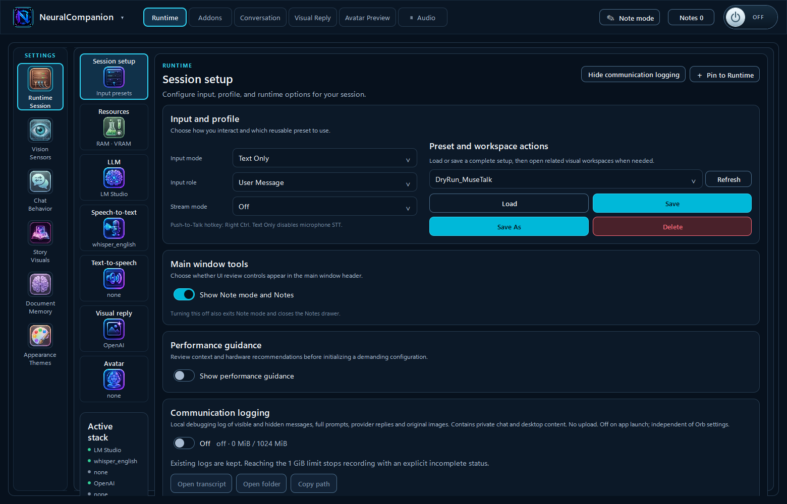

# First run

Start with one text conversation and no speech or avatar. Once that works, add speech, a face, and optional features one at a time so you can see which component needs attention.

Before beginning, complete [installation](installation.md). For local chat, start LM Studio or Ollama and make a chat model available. For hosted chat, have the provider's API access ready. You can also open **Addons → Tutorials → First Run → Start guide** and follow the same path inside the app.

## Find the main controls

Open **Runtime** for session and provider settings, **Conversation** to chat, and **Addons** for feature workspaces. **Runtime → Runtime Session** contains **Session setup**, **LLM**, **Speech-to-text**, **Text-to-speech**, **Visual reply**, and **Avatar**. The same Settings rail also opens **Vision Sensors**, **Chat Behavior**, **Story Visuals**, **Document Memory**, and **Appearance Themes**.

## Get your first text reply

1. Launch `run_neural_companion.bat`.
2. Open **Runtime → Runtime Session → Session setup**. Choose **Text Only** as the input mode. Leave the input role at **User Message** and streaming off for this first test.
3. Open **LLM** and select a provider to inspect its settings. For LM Studio or Ollama, start the local server, verify the server address, choose **Refresh**, and select a chat model. [LM Studio](../addons/lmstudio_sdk.md) is selected by default on fresh installations and uses the Python SDK. The optional REST provider is disabled in Add-ons by default. For OpenAI, xAI / Grok, DeepSeek, or Claude, enter the credentials and model.
4. Choose **Test connection**, read the result, then choose **Make active**. Check that the **Active language provider** badge is on the provider you expect. Viewing a provider's settings is not the same as activating it. **Test connection** probes the model catalog; the short chat reply below tests actual generation.
5. In **Text-to-speech**, select **None** and, if it is not already active, choose **Use for voice output**. In **Avatar**, select **None** and, if needed, choose **Use this avatar**. Leave Visual reply disabled for now.
6. Use the header power control, **Initialize NC**, once. Wait for startup to finish and read any readiness or error message. Do not press it repeatedly while startup is running.
7. Open **Conversation → Main chat**, type a short greeting, and choose **Send**.

The expected result is an assistant text reply with no speech and no animated avatar. If text fails, check the active provider, model, connection result, and the Conversation console before adding more components. See [Troubleshooting](troubleshooting.md).

A useful setup check:

| Check | Expected |
| --- | --- |
| Active language provider | The provider you configured, not merely the one you are viewing |
| Connection test | The provider’s model catalog can be reached; a sent reply verifies inference |
| Speech output | **None** active, so the reply is silent |
| Avatar | **None** active, so no avatar model is loaded |
| Header status | **NC ready** after initialization |

## Save the chat you want to keep

In **Conversation**, choose **Save** and give the chat a recognizable name. **Save as…** creates a separately named copy; **Load…** reopens an existing chat. If these controls are hidden, open **Controls** and enable their visibility options.

A saved or loaded conversation stays available when the engine stops. NC reopens it after restarting while its file still exists. Editing or deleting messages does not automatically update the named file, so save again after changes.

**Memory** beside the file actions opens the current chat's summary, older-message storage, and recall settings. Conversation memory is inactive until you save or load a named chat. It is optional for an ordinary first reply. See [Memory](memory.md).

## Choose an identity

Open **Addons → Persona** to select a quick persona, or create one with **+ New persona**. A persona supplies the companion's identity, prompt, voice, and related conversation defaults. Saving a persona is separate from saving the transcript. See [Personas](personas.md).

You can edit identity text without running a model. Generating portraits or testing synthetic speech needs the corresponding configured provider.

## Add speech, then optional features

Follow [Chat and speech](chat-and-tts.md) to activate a speech provider, select audio devices, and optionally enable microphone input. A compatible cloned voice can be assigned from **Persona → Voice**; **Addons → Voice Studio** manages the shared voice library.

After each successful test, add one feature at a time:

- an avatar in **Runtime → Runtime Session → Avatar**
- **Visual reply**
- **Document Memory**
- **Web Search**
- [MCP tools assigned to a saved persona](../addons/mcp.md#give-a-saved-persona-tools-for-normal-chat)
- an addon from the Addons rail

Installing an addon, configuring it, and making its provider active are separate steps. Some addon changes require an application restart; follow the status shown in Addon Manager.

The built-in **Tutorials** workspace contains guided tours of the current controls. Reading a step navigates to the feature; it does not activate providers, download models, or change your saves.

## End a session

Click the header power control while it shows **NC ready** to stop the runtime before closing its external services. Save important chat changes first. Stopping the engine does not unload the saved conversation, and external model servers may keep their own models loaded.

Main chat and Local Room share runtime resources and cannot run together. When switching, follow the guarded stop/save handoff and resolve any unsaved-conversation prompt.

If startup or a provider check fails, continue with [Troubleshooting](troubleshooting.md).

Use the [addon guide catalog](../addons/index.md) to find the setup for each
bundled addon, and [documentation coverage](../README.md) for the
current manifest-to-guide map and validation scope.
