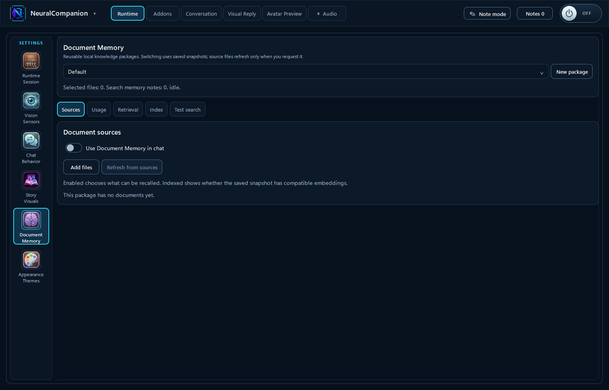

# Memory

In NeuralCompanion, "memory" covers several systems that are easy to confuse. Saving a chat preserves the transcript, but does not by itself make conversation memory active. Keeping a summary does not mean replies use it. Storing older messages does not mean NC searches them. Document Memory is a separate knowledge system with its own packages, embeddings, and source snapshots.

## The four systems

| System | Where to find it | What it keeps or supplies |
| --- | --- | --- |
| **Saved conversation** | **Conversation → Save**, **Save as…**, **Load…** | The named chat file you can reopen. This is the transcript, not the memory index. |
| **Conversation summary** | **Conversation → Memory → Conversation summary** | Short notes about the conversation. Keeping notes and using them in replies have separate controls. |
| **Stored older messages** | **Conversation → Memory → Older messages** | An archive of earlier turns. Storing them and allowing recall have separate controls. |
| **Document Memory** | **Runtime → Document Memory** | Reusable local knowledge packages built from selected files, with a package-specific search index. |

A persona can reference a Document Memory package through **Persona → Overrides**, but the package is not copied into the persona. Local Room has its own history and memory surface. Conversation memory and Document Memory do not share an index.

## Save the conversation first

Conversation memory is inactive until the current chat has a saved name. The **Memory** page shows this directly: **Conversation memory is inactive until you save this conversation. Your memory preferences are kept.**

1. Open **Conversation**.
2. Choose **Save** and give the chat a recognizable name.
3. To keep a separate version, use **Save as…**. To reopen an existing chat, use **Load…**.

The summary and archive switches and their actions are disabled for an unsaved conversation. If the **Memory** button is hidden, open **Controls** and turn on **Memory button**. Hiding the button does not disable memory.

A loaded saved chat stays available when the engine stops. NC reopens it after restarting while its file still exists. If that file is missing or unreadable, NC reports the restore error and leaves the conversation empty; it does not silently open a different chat. Editing or deleting messages does not automatically update the named file, so save again after changes.

## Open conversation memory

Use either route:

- **Conversation → Memory**
- **Runtime → Chat Behavior → Memory**

The page has three cards: **Conversation summary**, **Older messages**, and **Memory search**, followed by **Advanced settings**.

## Keep and use a summary

**Conversation summary** holds short notes that help NC follow a long conversation. The card has two independent choices:

- The **On/Off** switch keeps a conversation summary.
- **Use the summary in replies** controls whether those notes are given to the model when it answers.

You can keep a summary without using it, or use a previously kept summary in replies. **Read summary** shows the actual notes. **Update now** asks the configured chat provider to refresh them; opening the page or reading a guide does not send that request.

Automatic summary updates require all of the following:

1. A saved or loaded conversation.
2. The **Conversation summary** switch on.
3. **Enable Conversation Memory summarization** on under **Advanced settings**.

The automatic update interval and maximum summary size are also in **Advanced settings**. Saving the chat context also refreshes the summary when automatic summarization is on. A summary is compressed notes, not a complete transcript, and a long conversation can exceed what the summary keeps. **Forget Summary** removes the running summary while retaining the chat and the older-message archive.

### If Conversation Memory needs recovery

NC can report that Conversation Memory needs recovery when the saved summary file is unreadable, malformed, or from an unsupported version. The file is left unchanged, and summary updates pause before the chat provider is called. **Update now**, **Summarize Recent Messages…**, and automatic updates report the same problem instead of overwriting the damaged file with an empty summary.

To recover:

- Restore a valid copy of the named memory file, then use **Read summary** or **Update now**; or
- choose **Forget Summary** and confirm. That explicit clear writes an empty summary for the current conversation. Chat history and the older-message archive are retained.

A summary NC can still read may remain visible during recovery, but it is not used for a new update until the file is restored or explicitly cleared.

## Store and recall older messages

**Older messages** also has two independent choices:

- **Automatically store older messages** archives earlier turns.
- **Allow NC to search stored messages** lets relevant earlier details contribute to normal replies.

You can keep storing messages while recall is off. Use **Browse stored messages** to inspect what was retained, and **Find a memory** to search it for a specific detail. Stored details contribute to ordinary replies only when **Allow NC to search stored messages** is on.

Automatic older-message archiving requires a saved or loaded conversation and the **Automatically store older messages** switch on. The archive and its recall are separate from the summary: a summary can exist with no archive, and an archive can exist while summarization is off.

**Advanced settings** contains archive frequency, the number of archive notes per reply, recall text and image budgets, image review, repair tools, and export. Start with the defaults. If **Context messages** is smaller than the maximum pending archive batch, **Chat Behavior** can warn that recent messages might leave normal context before the search index includes them. The warning does not silently change your limit.

## Set up memory search

Keyword search is available without an embedding model. Meaning-based search uses an embedding model and is optional.

From **Conversation → Memory → Memory search**:

1. Choose **Set up memory search…**, or **Change setup…** when one is already selected.
2. In the provider list, select **LM Studio**, **Ollama**, or **OpenAI** to view its settings. This does not change your active chat provider.
3. In that provider's **Memory search model** card, choose **Refresh** and select an installed embedding model, or enter its name.
4. Read **Setup instructions**, then choose **Test memory search**.
5. Choose **Use for memory search** and review the confirmation with **Use model**.

The memory-search provider is independent of the chat provider. You can keep Claude or DeepSeek active for replies while using a local LM Studio or Ollama embedding model. Changing the chat provider does not automatically change memory search. OpenAI embeddings send text to that API and use your API account.

To return to keyword-only search, open the memory-search setup and choose **Use basic keyword search instead**. Stored messages are retained.

### Saved versus indexed messages

**Saved messages** and **indexed messages** can differ normally. For example, if archive batches are set to 8, a 26-message chat can show 26 saved, 24 indexed, and 2 waiting for the next batch. This is an illustration, not the default batch size. Saving keeps the last messages without forcing an index update for a partial batch.

A waiting batch is not a failure. **Retry indexing** appears when completed work needs attention. If you change the search model, review any rebuild prompt; the stored messages remain.

## Find a memory

Use **Find a memory** on the **Older messages** card. Enter a detail you expect to find, review the returned result, and then ask a related question in Conversation. This searches conversation memory.

This is different from **Test search** in Document Memory, which tests one knowledge package before you enable it in chat.

## Document Memory

Open **Runtime → Document Memory**. Document Memory is a reusable knowledge package built from selected local files. It is not a saved chat, a conversation summary, or the older-message archive.

The **Active knowledge package** selector at the top switches knowledge packages. **New package** creates another one. Each package has its own settings, index, and embedding model.

### Sources

**Sources** is where files enter the package.

- **Add files** accepts `.txt`, `.md`, `.markdown`, `.json`, `.log`, and `.pdf`.
- **Enabled** chooses what can be recalled.
- **Indexed** reports whether that source's saved snapshot has a compatible search index.
- **Use Document Memory in chat** controls whether the selected package contributes to chat at all.

**Refresh from sources** reads the original files again. **Refresh / Retry** does that for one source. **Remove** removes a source from the package. Disabling a source retains its saved index for later; removing it is a different action.

PDFs need extractable text. NC does not perform OCR or ask for a PDF password.
Image-only scans need text recognition in another tool first; files that cannot
be opened without a password cannot be imported.

### Saved snapshots are separate from originals

Document Memory keeps a saved snapshot of each source. Switching packages uses those snapshots. Changing the original file does not replace its snapshot just by opening a chat or switching packages.

- **Refresh from sources** reads the changed originals.
- **Rebuild saved embeddings** reuses the saved snapshots; it does not reread the originals.
- A ready saved version can remain usable until replacement indexing succeeds.

### Retrieval and per-package embeddings

**Retrieval** configures this package's semantic search model: model preprocessing, local embedding server, context size, target chunk size, overlap, and document/query prefixes. These settings are separate from the **Memory search model** used by conversation memory.

Edit all settings first, then choose **Apply changes…** and review the re-index confirmation. The saved settings remain in use until you confirm. **Revert edits** keeps the saved setup. Each package uses one embedding model for both indexing and search.

Advanced chunking is token-based for new packages. The package can keep an older character-based split until you apply the suggested token settings; its current index remains usable in the meantime.

### Index

**Index** shows progress and controls background indexing. Indexing waits until replies, recording, speech, and queued audio are idle. Use **Pause indexing** to defer work and **Resume indexing** to continue.

An explicit import, rebuild, or test search can load the package's embedding model even while chat recall is off. Disabled chat recall alone does not warm the model at startup.

### Usage

**Usage** chooses how retrieved excerpts are presented: **Reference documents** or **Integrated knowledge** presets, a **Memory prompt guide**, and whether source filenames and page labels are shown to the model. Selecting a starting prompt replaces the guide and source visibility; you can edit either before saving. Hiding source labels does not remove names already written in the document text. Choose **Save usage settings**, or **Reload saved usage** to discard unsaved edits.

Retrieved documents are reference material, not instructions to the assistant. Use **Test search** to verify what the package retrieves before enabling it in chat.

### Test search and enable recall

1. Add and index a small, verifiable source.
2. Open **Test search** and query a detail contained in it.
3. Review the returned excerpt and any diagnostics. Let model preparation and indexing finish before judging results; an empty result is different from an index or server error.
4. Return to **Sources** and turn on **Use Document Memory in chat** only when you want the selected package consulted by chat consumers.

Turning recall off stops that contribution, but saved sources and indexes remain available. A direct **Test search** or indexing request is an explicit operation and can still use the embedding model.

## Persona overrides for Document Memory

A saved persona can set **Document Memory override** to **Use defaults**, **Enabled**, or **Disabled**, and can select a **Knowledge package**. The package is referenced, not copied. Disabling recall keeps the package selection for later.

When recall is enabled, a selected package that is unavailable or not ready shows a warning and contributes no excerpts; the conversation continues. See [Personas](personas.md).

## What to check when memory does not appear to work

| Symptom | Check first |
| --- | --- |
| **Memory** is inactive or controls are disabled | Save or load a named conversation. |
| Summary exists but replies ignore it | **Use the summary in replies**. |
| Summary is stale | **Update now**, or enable automatic summarization and its interval. |
| Summary updates stop and the page names a memory file | Conversation Memory needs recovery. Restore that file, or use **Forget Summary** as the explicit clear. |
| Older details are not recalled | Check that the archive contains the detail and **Allow NC to search stored messages** is on. Enable automatic storage to retain future turns. |
| Saved and indexed counts differ | A pending batch; wait for idle indexing or use **Retry indexing** if it needs attention. |
| Memory search returns poor matches | Test the selected embedding model, its server, and the minimum similarity setting. |
| Documents are ignored | **Use Document Memory in chat**, the selected package, enabled sources, index readiness, and any persona override. |
| Changed original is not reflected | **Refresh from sources** for that source or the package. |
| Test search works but chat does not use it | Recall may be off, or a persona may be using a different package or disabling recall. |

## Good practices

- Save and name the chat before testing summary or archive controls.
- Test with a detail you can verify, then use **Find a memory** before relying on it in a long conversation.
- Change one memory setting at a time. Keyword search is a useful baseline before adding embeddings.
- Keep runtime data. Saved chats, archives, document snapshots, and indexes live under local runtime folders and are not a cloud backup.
- If NC reports that a memory file needs recovery, restore it or clear it deliberately. Do not hand-edit memory files while NC is running.
- Review where text is sent. Hosted embedding providers receive indexing and search text; local providers use their configured server.

See [Chat and speech](chat-and-tts.md) for provider setup, [Personas](personas.md) for overrides, and [Troubleshooting](troubleshooting.md) for missing or failed memory actions.
