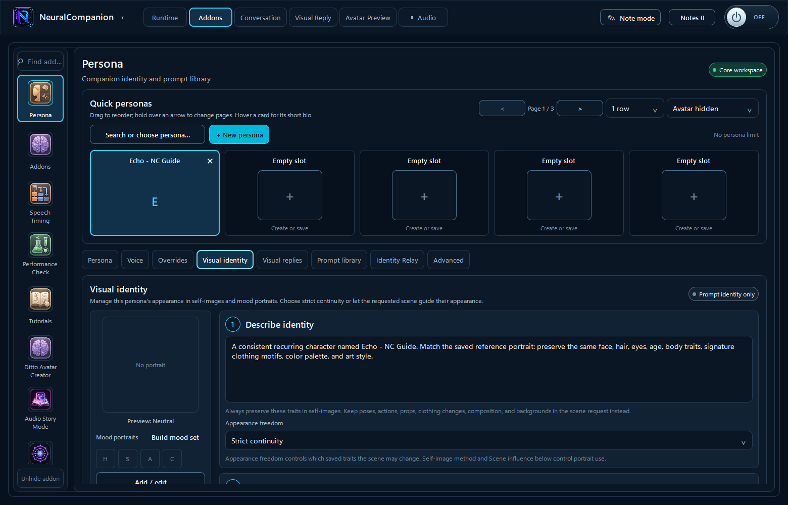

# Personas

A persona is the companion's reusable identity: its prompt, voice, portraits, and related conversation defaults. Saving a persona is separate from saving the conversation transcript. A different persona does not automatically give you a different chat history.

Open **Addons → Persona** to work with these tabs:

| Tab | What it controls |
| --- | --- |
| **Persona** | Quick-persona cards, name, bio, identity prompt, and prompt library access |
| **Voice** | Speech-provider voice and language, or a voice reference |
| **MCP** | Optional Chat MCP Tools assignments for this saved persona |
| **Overrides** | Provider-specific avatar/voice tag rules, language model, conversation context, and Document Memory behavior |
| **Visual identity** | The stable appearance description, reference portrait, mood portraits, and self-image guidance |
| **Visual replies** | Persona-specific image behavior and automatic display |
| **Prompt library** | Reusable prompts and quick prompts |
| **Identity Relay** | An imported identity record connected to this persona |
| **Advanced** | Lower-level persona and voice settings |

You can edit identity text without running a model. Generating portraits or testing synthetic speech needs the corresponding configured provider.

The optional **Chat MCP Tools** addon also contributes a **MCP** page for saved
personas. It assigns Core-approved tools to that persona; it does not grant
server access by itself. Follow [MCP connections and persona tools](../addons/mcp.md).

## Choose or save a persona

New persona libraries include the Echo NC Guide plus the owner-approved **Broid**
and **Nixie** starter cards, their reference portraits, mood portraits, and voice
samples. Starter data lives under `ui/assets/personas/`; your editable library
remains in `runtime/quick_personas.json`. Existing libraries and user edits are
not replaced on update. Nixie's saved LiquidAI voice uses the included adapter
at `models/LFM3-Audio-2B-Nixie-LoRA`; LiquidAI setup installs its base model.

1. Select an existing quick-persona card to activate it, or choose **+ New persona**. **Search or choose persona…** finds a saved card when the list is large.
2. Give it a recognizable name and review its identity prompt. Use **Prompt library** to load or save reusable prompts when useful.
3. In the prompt editor, choose **Save persona…**. Review the name and quick slot in **Save quick persona**, then confirm **Save persona**.
4. Select the saved persona and send a short message to check its behavior.

Quick-persona cards can be reordered by dragging. Hover a card to see its short bio. Conversation's persona controls let you switch without leaving the chat; use **Controls** if those controls are hidden. An edited draft is not a saved persona until you complete the save flow.

Saving a persona stores identity, prompt, voice, and visual behavior. Use **Save** in Conversation for the transcript. A complete session preset in **Runtime → Runtime Session → Session setup** is a separate save for a broader setup.

When backing up quick-persona cards, keep `runtime/quick_personas.json`, the
`runtime/quick_personas/` portrait folder, and their referenced voice recordings.
Saving a setup preset alone is not a backup of every card and portrait.

## Assign a voice

Open the **Voice** tab. Its controls follow the text-to-speech provider selected in Runtime.

With **LiquidAI**, choose a built-in voice or installed LoRA and a **Speech language**, then select **Apply to Persona**. The choices are saved with that persona and apply to new speech requests in chat and Local Room. **Use provider default** inherits the corresponding LiquidAI setting. Without a saved persona, **Apply to session** changes the session defaults instead.

Use **Refresh voices** after adding a LoRA folder, or **Open LiquidAI settings** for setup. LoRA voices may require their training language; choosing a speech language does not translate the reply. See [LiquidAI text-to-speech](liquidai-tts.md) for installation and voice folders. A missing saved voice stays visible as unavailable until you restore it or choose another.

For other speech providers, the library lists references from Voice Studio, plus **Provider default voice**. Switching providers preserves both the persona's LiquidAI choices and its reference recording.

1. Select a reference and choose **Play original sample** to hear its source.
2. To try your own words, load Chatterbox or Chatterbox Multilingual in **Runtime → Runtime Session → Text-to-speech**, then use **Generate test**. Original playback can work without the audition backend.
3. After changing the selection, choose **Use this voice for …**. The button reads **Voice already assigned** when no change is pending.
4. Confirm the assigned voice and test a short reply.

Previewing a voice does not change its assignment. **Provider default voice** uses the active provider's built-in choice instead of a reference recording. Available references must be compatible with the speech provider that will speak the reply.

**Addons → Voice Studio** creates and organizes additional references. Saving a WAV there does not automatically replace the chat voice. If original playback works but **Generate test** is unavailable, check that a supported audition backend is loaded; changing the persona alone does not load Chatterbox.

## Set persona-specific overrides

Save the persona first, then open **Overrides**. The tab shows **Save a persona first** when there is no permanent persona identity to attach the settings to. Controls inherit the conversation or room defaults until you explicitly override them.

- **Override language model** enables **Existing language model connection** and **Language model**. Configure the connection in Runtime first. An unavailable connection or model reports an error when requested; it does not fall back to another model.
- **Override conversation context** enables **Conversation context messages (0 = all)**. A value of `0` uses all available messages and can increase prompt size and model cost; it does not create unlimited model capacity.
- **Document Memory override** offers **Use defaults**, **Enabled**, and **Disabled**. **Knowledge package** selects one existing package or **Use configured default**. The package is shared by reference; its documents are not copied into the persona.

Choose **Save overrides** to apply the draft to that persona. **Use defaults for all** resets the draft; choose **Save overrides** to persist that reset. **Discard changes** reverts the current draft. Changes apply to new requests after saving and leave the Runtime and room defaults unchanged.

The effective summary shows whether each setting comes from the persona override or the conversation/room defaults. These settings follow the linked persona into main chat and Local Room without changing other personas or combining their conversation histories.

Disabling document recall keeps the package choice for later. When recall is enabled, an unavailable or not-ready package shows a warning and contributes no excerpts; the conversation continues normally. Enabling recall requires an available Document Memory addon and a ready package.

## Build a visual identity



1. In **Visual identity**, write **Describe identity** with stable traits: face, hair, eyes, species, palette, and art style. Put the requested action, pose, props, clothing changes, and background in each image request.
2. Import or generate a clear neutral portrait. Centered framing and a transparent background can make it more reusable in chat.
3. Choose the **Self-image method**: **Hybrid: prompt + portrait reference**, **Identity prompt only**, or **Portrait reference preferred**.
4. Review **Appearance freedom** for which identity traits a scene may change. In hybrid mode, **Scene influence** controls how freely the new scene changes the reference pose and framing.
5. Use **Build / refresh set** to generate or import mood portraits. The accepted neutral portrait can seed the mood set.
6. Save the persona, then test a simple self-image with the configured visual provider.

**Transparent avatar background** applies to persona portrait creation; it does not force every generated self-image to have a transparent background. A persona portrait is also separate from a prepared MuseTalk or Ditto animation pack. Preparing a chat portrait does not install an avatar engine or select an avatar.

In **Visual replies**, choose persona-specific image behavior and whether to auto-show the Visual Reply surface. Generated images remain attached to their assistant messages in Conversation and are available in Visuals.

## Avatar mood tags

An animated avatar follows control tags emitted by the language model. Ensure
the active persona's visual rules describe the tags supported by the selected
avatar provider. A visual identity description or a set of mood portraits does
not, by itself, instruct the model to emit those tags.

For **VSeeFace**, use this instruction block:

```text
VISUAL MOODS (State-based):
Insert one of these tags to make your graphical avatar take on a specific facial expression at any given moment.
Valid Tags: [neutral], [sad], [angry], [happy], [shy], [surprised]

Visual mood tags set the expression until the next visual mood tag.
They are control tags, not spoken words. Do not read them aloud.
```

For example, the model can reply `[happy] It is good to see you!` and use
`[neutral]` later to return to a neutral expression. These six tags are supported
by NC's VSeeFace provider; other avatar providers or packages can expose a
different set. Instructions cannot create an expression missing from a model
or avatar package.

### Current provider-specific controls

1. Select a saved persona in **Addons → Persona**.
2. Open **Overrides → Visual avatar tags** and choose **VSeeFace** as the avatar
   rules provider. Choosing it here edits its rules; it does not activate the
   avatar route.
3. If the inherited provider defaults already contain the desired instructions,
   leave **Override for this persona** off. Otherwise turn it on and enter the
   block above. **Copy provider defaults** can supply a starting point.
4. Click **Save persona overrides**. The rule applies when that persona uses
   VSeeFace; other providers retain their own rules.

If **Keep existing combined rules active** is shown and enabled, the preserved
custom avatar/voice instructions take precedence over the separate rules. Review
them using **View original rules**. To use the separate provider rules instead,
turn that switch off and save; the original text is preserved.

To set the default for personas that inherit VSeeFace's rules, open
**Runtime → Runtime Session → Avatar → VSeeFace**, edit **Default visual avatar
tag rules**, and choose **Save provider defaults**. A persona's enabled custom
override still takes priority.

### Earlier builds with the combined editor

If your build has **Advanced → Technical emotion and voice rules** instead of
the provider-specific controls, add the visual-mood block to its **Technical
rules** field. Preserve any voice-provider instructions you still need. Finish
editing and save the persona to retain the rules with that character.

### Verify the result

Activate the intended avatar provider, initialize the chat, then ask for a short
reply using `[happy]`. For VSeeFace, turn **Live Sync on** so chat tags can change
the face and body mood. With Live Sync off, the selected **Body emotion** is a
manual preview instead. If a manual expression works but chat expressions do
not, check the active persona, saved rules and tags the model actually emits.

See the [VSeeFace provider guide](../addons/vseeface.md#let-the-persona-trigger-facial-expressions)
for receiver, bridge and expression settings. These visual tags are separate
from TTS reaction tags such as `[laugh]` and `[sigh]`, whose support depends on
the voice provider.

## Prompt library and Identity Relay

**Prompt library** loads, saves, marks, or removes reusable prompts. Review a refined prompt before saving it. A library entry is not automatically the persona's active prompt.

**Identity Relay** connects an imported identity record to the persona. Review the imported record and privacy controls before allowing it into conversations. Selecting a persona or opening the tab does not enable the relay for chat.

**User Identity** is a separate addon for the human user's profile. It is not the companion's persona prompt. The user profile, an imported continuity record, and the companion's own instructions should not be treated as interchangeable.

## Troubleshoot persona behavior

- **Unexpected voice:** check the selected persona, the saved voice assignment on **Voice**, the active speech provider, and whether Conversation is using a session-only voice override.
- **Unexpected model:** check **Overrides** first, then the active **Runtime → Runtime Session → LLM** provider. A persona override does not change the global default.
- **Missing images:** check the visual provider, the accepted neutral portrait, and the requested scene. A portrait set is not a MuseTalk or Ditto pack.
- **Documents ignored:** check the override's **Document Memory** state, the selected **Knowledge package**, and the package's readiness. An unavailable package contributes no excerpts.
- **Settings did not apply:** confirm **Save overrides** or **Save persona** was completed. A draft that was only edited is not active.

See [Chat and speech](chat-and-tts.md), [Memory](memory.md), and [Troubleshooting](troubleshooting.md).
