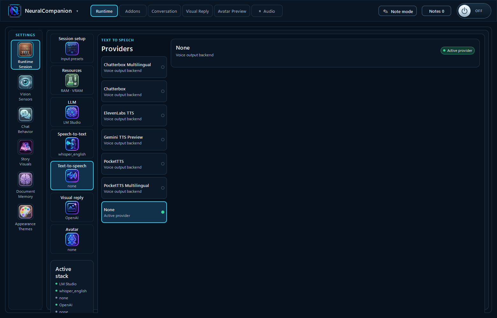

# PocketTTS

PocketTTS is a local text-to-speech provider with built-in voices and optional
reference-voice cloning. It runs in an isolated environment so its Python
packages do not collide with the main application or avatar runtimes.

PocketTTS and **PocketTTS Multilingual** are separate providers. Both use the
same isolated interpreter and pinned PocketTTS package, but expose different
language controls.

## Install and make a first test

Use the graphical installer's isolated PocketTTS component, or run from the
installation root:

```powershell
py -3.11 install_neural_companion.py --pockettts --non-interactive
```

The interpreter is installed under:

```text
.venvs/pockettts/
```

The installer uses NC's bundled PocketTTS 3.3.0 `py3-none-any` wheel, verifies its
SHA256 and package inventory before changing the environment, and validates the
worker API without loading a model. It does not download the moving GitHub branch
or build PocketTTS on the user's machine. Same-version installations are replaced
from the verified wheel without forcing dependency reinstallation.
Dependencies and model/voice assets retain their existing installation/access
behavior. Repair a missing or modified bundle from the same NC release; the
installer does not fall back to an online PocketTTS copy. This snapshot supports
both NC PocketTTS addons. See `vendor/pockettts/README.md` for origin and
maintenance.

The `vendor/pockettts/manifest.json` file records the wheel size, SHA256,
upstream commit, and license hash. Restore the whole `vendor/pockettts/` folder
from the same release; do not replace the wheel with a pip package from another
version.

The installer reports whether a Hugging Face login is present. Installation can
finish without one; built-in voices may still work while cloning is not ready.

1. Open **Runtime → Runtime Session → Text-to-speech** and select **PocketTTS**.
2. **Use cloned voice** is on by default. For the simplest first test, turn it
   off and choose a **Built-in voice**. Keep the advanced generation values at
   their defaults.
3. Select **Use for voice output**.
4. Initialize the conversation runtime and send a short sentence.
5. Confirm audible speech on the selected output device.



Opening settings or selecting the provider card does not create audio. The first
model use may take longer than later replies.

**Prewarm on runtime start** prepares the model during initialization. It can
make startup longer while reducing the delay before the first spoken reply. If
prewarming fails, speech may still work on the first real request.

## Built-in voices and cloning

When **Use cloned voice** is off, NC uses the selected **Built-in voice**.
**Auto (language default)** picks a sensible voice for the active language.
Individual voice choices are useful when you want a specific character sound.

When **Use cloned voice** is on, NC uses the voice reference assigned to the
active persona when one is available. Assign it in **Addons → Persona → Voice**
and choose **Use this voice for …**; previewing the reference does not assign it.
Saving a WAV in [Voice Studio](../addons/voice_studio.md) also does not assign it;
the studio library and the persona assignment are separate.
Use only recordings you have permission to use, and keep the reference file in a stable local location. A missing or
unreadable reference falls back to the provider's default voice behavior rather
than proving that cloning worked.

The first cloning test should use a short, clean reference with one speaker and
little background noise. Compare it with a built-in voice before changing
generation settings. Approved voice references distributed with NC follow the
[release asset policy](../release_asset_policy.md); references you add remain
local user assets.

## Hugging Face access for cloning

Installation can complete without a Hugging Face login. Cloning may still need
model access. The model page is gated: sign in and accept its conditions before
the gated files can be used.

1. Review and accept the applicable terms on the
   [PocketTTS model page](https://huggingface.co/kyutai/pocket-tts).
2. Authenticate using the isolated environment:

```powershell
.\.venvs\pockettts\Scripts\hf.exe auth login
```

The installer prints this step when it does not detect a login. It cannot verify
that every gated model term was accepted. Use a Read token created on the Hugging
Face settings page, and enter it only in the CLI prompt. Do not paste tokens into
chat, a persona, a preset, or a screenshot.

A successful account check proves login, not cloning readiness. Check both the
account access and the model terms.

## Language and advanced generation

**PocketTTS Multilingual** has **Language and voice** controls for:

- English
- French
- German
- Spanish
- Portuguese
- Italian

Choose the language first, then **Built-in voice** or **Use cloned voice**.
Selecting a language in ordinary PocketTTS does not make it multilingual; use
the multilingual provider and check its runtime readiness.

The advanced generation controls are:

- **Temperature**
- **LSD decode steps**
- **End-of-speech threshold**
- **Frames after end-of-speech**

Change one value at a time after a working short sentence. Higher or unusual
values can make speech cut off, run long, or sound unstable. They are not a
substitute for fixing a missing interpreter or model.

## Runtime override

**PocketTTS Python override** is under **Advanced runtime**. Leave it blank for
normal discovery of `.venvs/pockettts/`.

Use an override only with a compatible, verified environment. Pointing it at the
main application interpreter is not a repair; PocketTTS needs its own installed
packages. After changing the interpreter, initialize the runtime again.

## Troubleshooting

- **Built-in speech works, cloning fails:** check reference availability,
  **Use cloned voice**, account access, and model-term acceptance first.
- **Interpreter or package unavailable:** verify that the isolated component was
  installed. Clear the Python override to return to normal discovery.
- **Long first reply:** wait for model readiness and check whether prewarming is
  enabled before changing generation values.
- **Speech cuts off or sounds unusual:** retry a short plain sentence with
  defaults, then change one advanced value at a time.
- **No audio from any voice:** check the active TTS route, runtime status, and
  output device before changing the cloning setup.
- **Multilingual language is ignored:** confirm that **PocketTTS Multilingual**
  is the active provider and that its language control is set as intended.

If the isolated `hf.exe` is missing, repair the CLI inside that environment only:

```powershell
.\.venvs\pockettts\Scripts\python.exe -m pip install --upgrade "huggingface_hub[cli]"
```

This is a targeted recovery step, not a requirement to upgrade a working setup.
