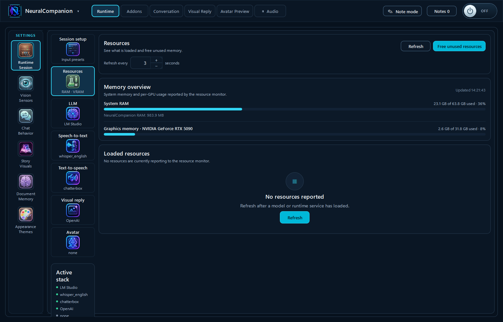

# Resources: RAM, VRAM, and idle models

Open **Runtime → Runtime Session → Resources** to see what is resident in memory
and release eligible idle resources. Opening the page inspects existing state;
it does not initialize NC or load a model.

This native screenshot shows a read-only inspection of the capture computer.
The models, totals, devices, and available cleanup actions depend on your setup.

## Read the overview

**Memory overview** shows system RAM, NC process RAM, and available per-GPU memory
measurements. System totals include other programs. An unavailable measurement
is shown as unavailable rather than as zero.

**Loaded resources** lists the resident instances that configured providers and
loaded addons can report. Expand a row for its owner, model, device, current
users, memory measurements, and any reason unloading is blocked. Multiple rows
can belong to the same server or process.

Values labeled **shared** describe a process or shared allocation, not memory
owned exclusively by that one row. Do not add shared row values together to
estimate total RAM or VRAM. Use the overview totals for the whole system.

## Refresh the view

- **Refresh** requests a new snapshot.
- **Refresh every** sets the page's automatic interval in seconds, from 1 to 59;
  the initial interval is 3 seconds.
- Automatic polling runs while the Resources page is active. Expanded rows and
  their focus are preserved as telemetry updates.

If inspection fails, read the error and refresh after checking the relevant
provider or addon. Previously seen rows can remain visible, but stale information
does not authorize unloading.

## Release idle resources

Choose **Unload** on a row to release that exact eligible resource. **Free unused
resources** attempts cleanup across the eligible idle resources. The service
checks current usage again when executing an action; a row that became busy
after the last refresh can be refused.

Stop the relevant chat, room, preview, or creator job and wait for it to finish
before trying to release resources it owns. NC protects active model requests,
startup/shutdown transitions, speech/avatar work, and memory searching/indexing.
Read the row's status and blocked reason instead of repeatedly submitting the
same action.

Supported local model servers and addon runtimes report their own residency.
Hosted chat services do not expose a local model instance for NC to unload.
The list does not enumerate every model used by unrelated applications.

Ditto reports one shared worker for avatar playback and Avatar Creator. Its
**shared** RAM/VRAM values are process measurements, including models, prepared
features, and worker overhead. These measurements include its child interpreter
processes, which can hold the GPU allocations on Windows. Unavailable
measurements remain unavailable.
Inspection does not start Ditto or load its models. Stop its chat/preview and
wait for preparation or rendering to finish before using **Unload** or **Free
unused resources**. Cleanup confirms the worker has exited; an unconfirmed exit
remains visible for retry. Prepared avatar files and packages are preserved.

## How this relates to memory features

Resources uses **memory** in the RAM/VRAM sense. Document Memory and saved
long-term conversation memory can also use resident search models. An idle
search model may be released and loaded again when needed.

Unloading a model does not delete your documents, indexed knowledge, saved
conversation memories, chat files, or the current chat's messages. Those have
their own controls in the [Memory guide](memory.md). Likewise, **Free unused
resources** is not a command to clear conversation context.

For response latency, model warm-up, profiles, and chunk timing, see
[Performance and speech timing](performance.md).
