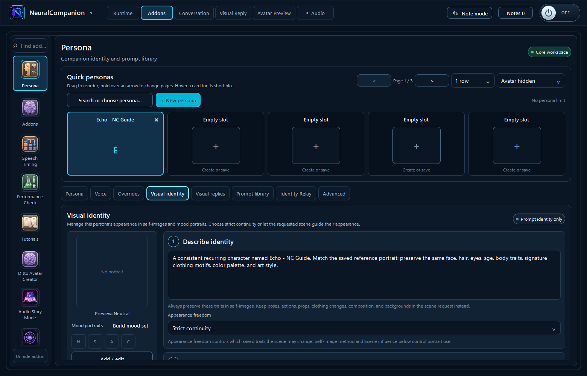

# Appearance consistency and freedom

**Appearance freedom** is an optional per-persona setting for generated scene
images. It controls how much authority the current scene has over a character's
saved look. The saved avatar image and the speaking-chat portrait are not changed.

The default is **Strict continuity**. A missing or invalid saved value also falls
back to Strict, so existing personas keep their previous behavior until you
change the setting.

## Where to change it

- **Main Chat:** select the persona, then **Persona > Visual identity >
  Appearance freedom**.
- **Multi Persona Roleplay:** select the persona, then **Story Images > Image
  direction > Appearance freedom**.

The setting is saved with the persona. Changing it does not generate an image by
itself; it affects the next eligible Visual Reply or story-scene request.

## Strict continuity

**Strict continuity** keeps the saved appearance instructions and the existing
self-image behavior. Main Chat continues to use the persona's **Self-image
method** and **Scene influence** settings as before.

Use Strict when the character's clothing, hair, makeup, and overall presentation
must remain recognizable from image to image.

## Flexible appearance

**Flexible appearance** treats the saved appearance as an identity anchor rather
than a complete costume or pose prescription. The current scene gets priority
for presentation.

In Main Chat, the flexible prompt keeps the recognizable face, apparent age,
gender presentation, core hair and eyes, species, palette, and art style. The
scene may change pose, expression, clothing, props, background, composition, and
framing. Multi Persona Roleplay describes its flexible mode as also allowing
scene-led hair, makeup, and facial styling. The saved avatar itself is unchanged.

This is not an age-change or random-character switch. It is prompt guidance, not
a guarantee that every provider will preserve every trait.

## References and portraits

Flexible appearance does not disable the persona reference by itself:

- **Self-image method > Prompt** does not attach a persona reference portrait.
- **Hybrid** or **Reference** can still attach the saved portrait when one is
  available. NC asks the provider to use it for identity and style, not for the
  reference's pose, background, or framing.
- If the scene includes a human user reference in a joint image, that reference
  remains attached and both identities remain constrained.
- Avatar creation and mood portraits keep their existing portrait-continuity
  behavior. Appearance freedom applies to generated scene visuals, not to making
  the avatar itself.

If a saved portrait is strongly influencing clothing or composition, switch the
**Self-image method**, not just Appearance freedom, and compare the result.

## Multi Persona Roleplay

For MPRC, the policy travels with the selected persona's story images. MPRC scene
requests use the story prompt rather than automatically attaching the saved
avatar as a reference.

**Preview Image Prompt** shows the prompt NC can assemble from the current reply
and settings. It is a local preview and may not include every later LLM
refinement, so treat it as a check on direction rather than an exact rendering
promise.

For **Flexible** MPRC requests, manual generation uses the latest story reply.
Auto generation still depends on the persona's trigger mode, cooldown, session
image limit, and the active Visual Reply provider.

## Limits and interactions

- Prompt instructions cannot force a specific result from every image model.
- A global master-style prompt or negative prompt that explicitly forces a
  costume, hairstyle, or art style can compete with scene guidance. NC does not
  silently rewrite those global settings.
- Flexible appearance changes generated images only. It does not edit the saved
  avatar, speaking portrait, persona prompt, chat history, or Visual Reply
  provider configuration.
- A phone client must support the same appearance policy for remote generation.
  If a remote request does not honor the desktop setting, update the phone client
  before treating it as a desktop bug.
- Use a fixed provider, model, size, and seed when comparing Strict and Flexible.
  Changing several variables at once makes the result impossible to interpret.

## A simple comparison

1. Choose one persona and keep the provider, model, size, and seed constant.
2. Generate the same non-sensitive scene in **Strict continuity**.
3. Switch to **Flexible appearance** and request an explicit change in clothing,
   pose, or setting.
4. Compare whether the scene change is followed while the face and core identity
   remain recognizable.
5. Switch back to **Strict continuity** and confirm the saved avatar and speaking
   portrait are still unchanged.

If the new look appears but identity drifts, strengthen the visual identity
description or use a reference-capable method. If nothing changes, confirm that
the request actually asks for a visual change and that the active provider is
receiving the scene prompt.
